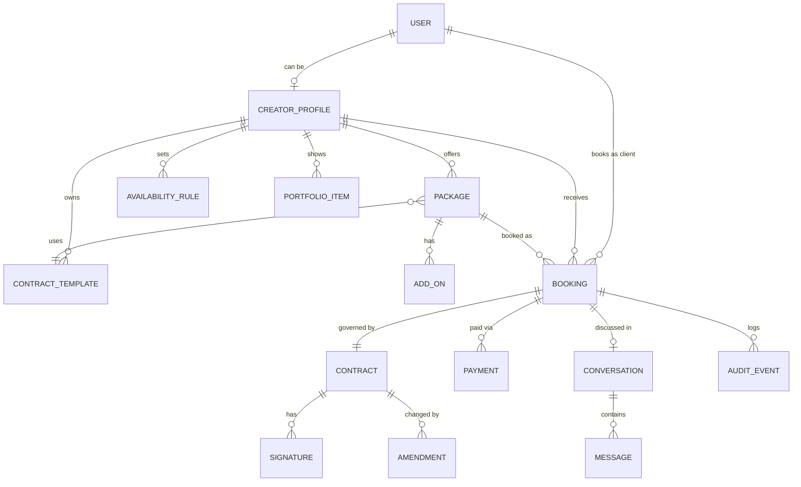
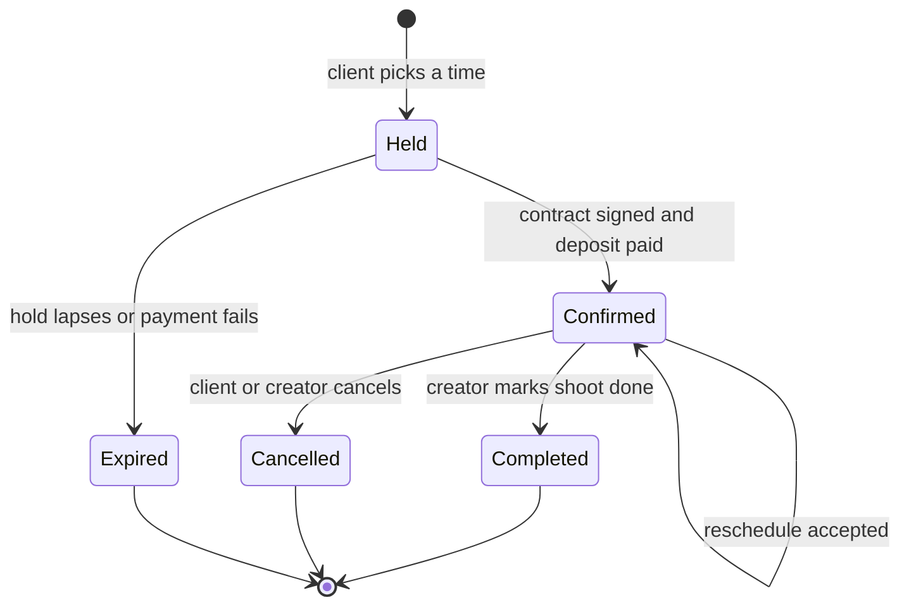

# Product Spec: Booking with Built-in Contracts for Creators

**Status:** Draft v0.1 · 2026-10-21 · Working title: *Slate* (placeholder)
**Platform:** iOS and iPadOS first (SwiftUI). A lightweight web booking page for clients. No code is written yet.

---

## 1. Summary

An iOS app for videographers, photographers and freelance creators to sell their services and get booked, in the way Booksy does for salons. The difference is that **every booking produces a signed contract**. Clients can't book without agreeing to the creator's terms, and creators never chase signatures, deposits or "what did we agree?" threads.

**Positioning:** Booksy handles scheduling and payment for appointments. Creators who shoot weddings, events, brand work or portraits have a different problem. Each job has scope, deliverables, usage rights, travel, a deposit and cancellation terms, and those usually live in a PDF, a DM thread and a payment link. This app puts them in one flow.

**The promise:**
- *Creator:* share one link and receive bookings that are already signed and deposit-paid.
- *Client:* pick a package and a time, then sign and pay in three taps or fewer.

## 2. Decisions locked and assumptions

Decisions made with the product owner:

| # | Decision | Consequence |
|---|---|---|
| D1 | **Design rules** are the Apple-native rules (section 3). No CLAUDE.md exists in the repo. | Section 3 is normative. A CLAUDE.md should be created from it (see section 13). |
| D2 | **Creator booking link first.** There is no marketplace or search in the MVP. | No cold-start problem. The creator brings their own audience. Discovery is a later phase. |
| D3 | **Contracts = templates plus in-app e-signature.** The creator attaches a template to each package. The client reviews and signs inside the booking flow. We store a timestamped audit trail and a PDF. | We build template, signing and PDF/audit infrastructure ourselves. Legal review is required before launch. |
| D4 | **Payments = deposit at booking** via Apple Pay and Stripe Connect. The balance is due later. | A booking is confirmed only when the contract is signed and the deposit is paid. |

Assumptions, open to change (section 13):

- **A1.** The MVP launches in one country (US, USD) under ESIGN/UETA.
- **A2.** Clients can book without installing the app. The booking link opens the app if installed and otherwise a minimal web page. An App Clip is the alternative to evaluate (section 13, Q4).
- **A3.** Minimum OS is iOS 17. Newer system looks (e.g. Liquid Glass) come from using system components, not custom chrome.
- **A4.** Instant booking only. A creator-approval "request to book" mode comes later.
- **A5.** The backend is required (contracts, payments, web link, email) and is built or bought separately from this spec.

## 3. Design rules (normative)

These come from the product owner's brief and apply to every screen.

| Rule | How it applies here |
|---|---|
| Swift and SwiftUI, iOS/iPadOS first, follow Apple's HIG | No custom navigation paradigms. The web booking page mirrors the same visual language (system font stack, `prefers-color-scheme`). |
| System fonts (SF Pro), Dynamic Type, SF Symbols, system colors | Light and Dark Mode come for free. Contracts and booking screens must stay usable at the largest accessibility text sizes. |
| Native patterns: `NavigationStack`, `TabView`, sheets with detents, swipe actions, pull to refresh, context menus | Tabs: **Home, Bookings, Services, Messages, Profile**. The booking flow is a sheet with `medium` and `large` detents. Bookings and messages use swipe actions. Packages, bookings and contracts use context menus. Lists support pull to refresh. |
| Generous whitespace, rounded cards, subtle materials, spring animations, haptics on key actions | Haptics: slot selected, contract signed, payment succeeded, booking cancelled. Animations respect Reduce Motion. |
| Sign in with Apple, Apple Pay, EventKit, push, widgets | See sections 5 and 8. |
| Accessibility first: VoiceOver labels, contrast, 44pt targets | A typed signature is the default so signing never depends on drawing precision. A drawn signature always has a typed alternative. Contract clauses are exposed as headings for VoiceOver. The PDF is tagged. |
| **Booking takes 3 taps or fewer** | Defined precisely below. |

**The 3-tap rule, defined.** Taps are counted from the tap that opens the booking sheet to the tap that confirms. System authentication (Face ID, side-button confirmation for Apple Pay) and typing don't count as taps.

| Path | Taps | Notes |
|---|---|---|
| Choose package → choose time → **Sign & pay deposit** | **3** | The earliest slot is preselected, so accepting it makes this 2. |
| "Book again" from Home → **Sign & pay deposit** | **2** | Same package, earliest slot preselected. |
| Add-ons, a different day, or editing the signing name | +1 each | Optional and opt-in. The "Soonest available" chips show the next several slots across days, so a different day is rarely needed. |
| **Exceptions** | >3 | (a) First-time web guests must verify an email code. (b) Creators can require a drawn signature or a full read-through on high-value packages. Both are documented exceptions, and each must be justified in the design review. |

Contracts and 3 taps seem to conflict, and the design resolves it this way. The contract is *summarised* in a key-terms card inside the booking sheet (what, when, where, price, deposit, balance due date, cancellation terms, usage rights, delivery date). The full text is one tap away. The primary button is labelled **"Sign & pay $X deposit"**. Next to it sits the signer's name (prefilled from their Apple ID) and a consent line: *"By tapping, I agree to the contract and sign it electronically."* Whether this is enough for enforceability is a legal question (section 12, R1).

## 4. Roles

One account (Sign in with Apple) can hold both roles. A photographer can hire a videographer. The role is a capability on the account, switched from Profile.

| | **Creator** | **Client** |
|---|---|---|
| Who | Videographer, photographer, freelance creator who sells packages | A person or business booking a creator (couples, event hosts, brands, agencies) |
| Identity | Sign in with Apple, then creator onboarding (legal name, Stripe Connect) | Sign in with Apple in the app. On web: name and email, verified by a one-time code (guest). A guest account can be upgraded later. |
| Surfaces | iOS app only in the MVP | iOS app or web booking page |
| Core jobs | Set up packages, contracts and availability. Share the link. Get paid. Manage bookings and changes. | Pick a package and time. Understand the terms. Sign and pay. Keep the contract. Reschedule or cancel. |

Out of the MVP: studio or team accounts (second shooters, assistants, managers), and an internal support/admin role. The MVP does include a **minimal internal console** for support (view a booking, contract and audit log, void a contract, refund). It isn't customer-facing.

**Permissions at a glance**

| Capability | Creator | Client |
|---|---|---|
| Create and edit packages, templates, availability | Yes | No |
| Book a package | Yes (as a client of another creator) | Yes |
| View a booking and its contract | Own bookings | Own bookings |
| Cancel a booking | Yes (full refund to client) | Yes (refund per policy) |
| Propose a reschedule | Yes | Yes (the other party accepts) |
| Message in a booking thread | Yes | Yes |
| Edit a signed contract | No, only amendments accepted by both parties | No |

## 5. Core features

Legend: **MVP** = in the first release. **Later** = post-MVP.

### 5.1 Creator

| Feature | Detail | Phase |
|---|---|---|
| Onboarding | Sign in with Apple, then business name, handle, legal name and address (needed in contracts), categories, then Stripe Connect Express onboarding. Target: link live in under 10 minutes. | MVP |
| Profile and portfolio | Bio, location and travel radius, up to 12 images, external video links (YouTube/Vimeo). | MVP |
| Packages | Name, description, duration, fixed price, deposit (percent or fixed), deliverables list, delivery turnaround, location type (on-location, studio, remote), travel fee, add-ons, cancellation policy, attached contract template. | MVP |
| Contract templates | Starter templates plus a clause editor with merge fields. Versioned. Creator authorises auto-countersign at publish. See section 6. | MVP |
| Availability | Weekly hours, date exceptions, buffer before and after, minimum notice, maximum advance, max bookings per day. | MVP |
| Booking link | `handle` URL and QR code, shared with the system share sheet. Opens the app if installed, else the web page. | MVP |
| Bookings dashboard | Upcoming, past, needs-attention (balance overdue, change requested). Swipe actions and context menus. | MVP |
| Changes | Accept or decline a reschedule. Cancel with a refund. | MVP |
| Messages | One thread per booking. System messages for events. | MVP |
| Earnings | Read-only summary of payments and Stripe payouts. | MVP |
| Calendar | Confirmed bookings added to Apple Calendar via EventKit. | MVP |
| Widget | "Next shoot": small, medium and lock-screen accessory sizes. | MVP |
| Import busy times from personal calendars | Avoid double-booking against non-app events. | Later (fast follow) |
| Request-to-book, custom quotes and proposals | For bespoke jobs. | Later |
| Second shooters, team accounts | | Later |
| Client gallery delivery | Integrate with an existing gallery tool rather than build one. | Later |

### 5.2 Client

| Feature | Detail | Phase |
|---|---|---|
| Book from a link | Package, optional add-ons, time, key terms, sign and pay. | MVP |
| Sign in | Sign in with Apple, or on web a name and email verified by a one-time code. | MVP |
| Pay deposit | Apple Pay (iOS and Safari). Card fallback on web through Stripe. | MVP |
| My bookings | Status, contract, payments, next steps. | MVP |
| Pay balance | One-tap Apple Pay from a reminder, due N days before the shoot (default 7). | MVP |
| Change or cancel | Reschedule request. Cancel with refund shown per policy *before* confirming. | MVP |
| Contract access | Signed PDF in the booking, shareable from the system share sheet. Emailed to both parties. | MVP |
| Messages | Booking-scoped. | MVP |
| Calendar, reminders, widget | EventKit event with an alarm. Push at 24 h and 1 h. | MVP |
| Saved creators and rebook | The client's **Services** tab shows creators they've booked, with their packages. | MVP |
| Reviews and ratings, discovery and search | | Later |

### 5.3 Platform

Backend API, Stripe Connect integration, PDF generation, append-only audit log, transactional email, APNs, universal links, and the minimal support console.

## 6. Contracts

This is the differentiator, so it gets its own section.

**Templates**
- Three **starter templates**: wedding or event, portrait or session, and commercial or brand. They are clause-based and editable.
- A template is an ordered list of clauses. Each clause has a title and body and can use **merge fields**: client name, event date, location, package name, price, deposit, balance due date, deliverables, delivery date, cancellation terms, usage rights, travel fee, overtime rate.
- Clauses are either editable or **system-locked**. Locked clauses include the e-sign consent and the parties block.
- Editing a template creates a new **version**. Existing bookings keep the version their client signed.
- Starter templates are not legal advice and are marked as such in the app.

**At booking**
1. The system merges the booking data into the package's template and produces an **immutable contract instance**: the rendered text, the template version, and a SHA-256 hash of the document.
2. The client sees the key-terms card and can open the full text.
3. The client signs with a **typed signature** (default, prefilled) or a **drawn signature** (creator option).
4. The creator's **countersignature** is applied automatically from their stored signature, under the authorisation they gave when publishing the template.
5. When the deposit succeeds, the contract becomes **executed** and the booking becomes **confirmed**.

**Signature record and audit trail** (per signer): signed name, method, consent-text version, timestamp, IP address, device and user agent, locale, email at signing, and how the identity was verified (Apple ID or email code). The executed PDF carries a **certificate page** with this data and the document hash.

**Ordering rule.** Signing and paying happen in one step. If payment fails or the hold lapses, the signature is voided, the contract never becomes executed, and the client is told. Money and a contract are never in a half-finished state that either party can rely on.

**Changes after signing.** Rescheduling, scope changes and cancellations produce an **amendment** that both parties must accept. The original contract is never edited. A cancellation records the outcome and the refund applied.

**Retention and deletion.** Account deletion is available in-app (App Store requirement). Executed contracts must be retained for legal reasons, so deletion removes personal data where the law allows and retains the contract and audit record. The retention period is an open question (Q10).

## 7. Data models

Entities, key fields and relationships. This is a conceptual model, not a schema.

| Entity | Key fields | Notes |
|---|---|---|
| **User** | id, Apple subject id (nullable for guests), email, email verified, display name, timezone, locale, roles (client always, creator optional), deleted at | Guest clients are Users created by email code and can be merged into an Apple ID later. Hide My Email relay addresses are supported (section 12, R6). |
| **CreatorProfile** | handle (unique), business name, legal name, legal address, bio, categories, base location and travel radius, currency, stripe account id, charges and payouts enabled, stored signature, published flag | Publishing requires charges enabled. A private preview link works earlier. |
| **PortfolioItem** | kind (image or video link), url, caption, order | Up to 12 per creator in the MVP. |
| **Package** | name, description, category, duration, price, deposit rule, deliverables, turnaround days, location type, travel fee, cancellation policy, buffer before and after, template id, status (draft, active, archived) | Booking stores a **snapshot** of the fields below, so later edits never change an existing booking. |
| **AddOn** | package id, name, price, extra minutes, description | Examples: extra hour, second shooter, drone, rush delivery. |
| **AvailabilityRule / Exception** | weekday, start and end, timezone; exception date, blocked or extra, window; settings: minimum notice, maximum advance, daily cap | |
| **CancellationPolicy** | name, rules (hours before → refund percent), applies to deposit and balance | MVP ships three presets: Flexible, Moderate, Strict. Custom policies come later. |
| **ContractTemplate** | creator id or system, title, category, version, clauses (title, body, locked), merge fields used, status, auto-countersign authorised at | Starter templates are system-owned and cloneable. |
| **Contract** | booking id, template id and version, rendered body, document hash, parties, status (pending signature, executed, voided, superseded), executed at, PDF url, certificate url | Immutable once created. |
| **Signature** | contract id, signer role and user, signed name, method (typed, drawn, stored), consent-text version, signed at, IP, device, locale, email at signing, verification method | |
| **Amendment** | contract id, reason, change summary, proposed by, status (proposed, accepted, declined), accepted by both at | Used for reschedules and scope changes. |
| **Booking** | creator id, client id, package id, **package snapshot**, add-ons snapshot, start and end, timezone, location, client brief, status, total, deposit, balance, balance due at, cancellation policy snapshot, contract id, created via (app, web), hold expires at, cancelled by and reason | |
| **Payment** | booking id, kind (deposit, balance, refund, adjustment), amount, currency, platform fee, Stripe payment intent id, status, method (Apple Pay, card), paid at | Money is stored in minor units. |
| **Payout** (read-only mirror) | creator id, Stripe payout id, amount, status, arrival date | For the earnings screen. Stripe is the source of truth. |
| **Conversation / Message** | booking id, participants; sender, kind (text, system), body, sent at, read by | System messages are generated for booking, signing, payment and change events. |
| **Device / NotificationPreference** | user id, APNs token, environment; per-event toggles | |
| **AuditEvent** | entity type and id, actor, action, metadata, IP, timestamp | Append-only. Covers bookings, contracts, payments and changes. |

**Booking lifecycle**

- A **Held** booking reserves the slot for 10 minutes (proposed) so two clients can't book the same time.
- **Balance** is a payment state, not a booking state: `balance due`, `paid`, `overdue`. Overdue balances notify both parties and surface in the creator's needs-attention list.
- If the **creator cancels**, all payments are refunded in full automatically.
- If the **client cancels**, the refund follows the policy snapshot stored on the booking.

## 8. User flows

### 8.1 Creator onboarding and first link

1. Sign in with Apple.
2. Basics: business name, handle, categories, legal name and address (explained: "used in your contracts").
3. First package from a starter, with a starter contract template preselected. The creator can accept defaults and edit later.
4. Availability, prefilled Monday to Friday, 9:00 to 17:00, editable.
5. Stripe Connect Express onboarding in a system web authentication sheet. Stripe handles identity checks.
6. Authorise auto-countersign and store a signature.
7. Publish, then share the link and QR code through the system share sheet.

*Success:* a published link in under 10 minutes, excluding Stripe's own verification time. Until Stripe verification completes, the creator can use a private preview link only.

### 8.2 Client books (link to confirmed)

1. Client opens the link. If the app is installed it opens there. Otherwise the web page opens.
2. **Tap 1:** pick a package. The booking sheet opens with the earliest slot preselected.
3. **Tap 2:** pick a time from the "Soonest available" chips. Optional: add-ons, or "Other dates" for a full day and time picker.
4. The sheet shows the key-terms card, a "Read full contract" link, the signer name (prefilled), and the price breakdown (total, deposit now, balance later with due date).
5. **Tap 3:** **Sign & pay $X deposit**. Apple Pay authorises with Face ID or the side button.
6. Confirmation: haptic, animation, "Add to Calendar", signed PDF available, emails sent, creator notified.

*Failure paths:* payment fails (signature is voided, the client can retry within the hold), hold expires (offer the next slot), slot taken meanwhile (offer alternatives), Apple Pay unavailable (card fallback on web, "Add a card" prompt in the app).

### 8.3 Balance payment

1. N days before the shoot (default 7), push and email: "Balance of $X due."
2. Client taps the notification, then **Pay balance** with Apple Pay.
3. Creator sees "Paid in full". If still unpaid after the due date, both are notified and the booking appears under the creator's needs-attention list.

### 8.4 Reschedule

1. Either party taps **Reschedule** (swipe action or context menu) and picks a new time inside the creator's availability.
2. The other party gets a notification with the proposed time and accepts or declines.
3. On acceptance, an amendment is recorded and signed by both parties, the calendar event and reminders update, and the signed amendment is appended to the contract PDF.

### 8.5 Cancel

1. Either party taps **Cancel**. A confirmation sheet shows the **exact refund** the policy produces *before* the final tap.
2. The booking is cancelled, the refund is issued, the contract is marked terminated with the outcome, and both parties are notified.
3. The calendar event and reminders are removed.

### 8.6 After the shoot

1. The creator marks the booking **Completed**.
2. If the balance is unpaid, the reminder flow continues. If it's paid, the booking moves to Past.
3. Both can still open the signed PDF at any time.

## 9. Screens and navigation

One `TabView` with five tabs, **role-aware**. Each tab owns a `NavigationStack`. Tab labels are the same for both roles.

| Tab | Creator | Client |
|---|---|---|
| **Home** | Today and this week, needs-attention list, link and QR shortcut, earnings snapshot | Next booking, "Book again", action items (balance due) |
| **Bookings** | Upcoming and Past, swipe actions (reschedule, cancel), detail with contract and payments | Same, plus pay balance |
| **Services** | Packages, contract templates, availability, portfolio | "Creators": those the client has booked or saved, with their packages |
| **Messages** | Booking threads, unread badge | Booking threads |
| **Profile** | Business profile, Stripe and payouts, calendar and notification settings, role switch, sign out, delete account | Account settings, payment methods, calendar and notification settings, role switch, sign out, delete account |

**Key surfaces:** the booking sheet (`medium` and `large` detents), the full-contract reader (`large` sheet), signature capture, the cancel confirmation (shows the refund), widgets, and push notification actions.

## 10. MVP scope

**Release goal.** A creator can set up and publish a bookable link in under 10 minutes. A client can book, sign and pay a deposit in three taps or fewer. Both receive a signed PDF. The creator receives the money.

**In the MVP:** everything marked **MVP** in section 5, plus the platform pieces in 5.3.

**Not in the MVP:**

| Area | Deferred |
|---|---|
| Discovery | Marketplace, search, categories, ratings and reviews |
| Booking modes | Request-to-book, custom quotes and proposals, recurring bookings, waitlists |
| Money | Installments and milestones, invoices beyond deposit and balance, tax, multi-currency, promo codes, creator subscriptions |
| Contracts | Third-party e-sign providers, model and property releases, usage-rights licensing add-ons, AI drafting |
| Teams | Studio accounts, second shooters, assistants |
| Integrations | Google Calendar or personal-calendar busy-time import, client gallery delivery |
| Platform | Android, iPad-specific features beyond adaptive layout, Live Activities, in-app video calls |
| Support | Dispute and chargeback tooling beyond the minimal support console |

**Proposed success metrics** (targets to be confirmed; these are not commitments):

| Metric | Why it matters |
|---|---|
| Creators with a published link and at least one package, divided by sign-ups | Activation |
| Link views to confirmed bookings | Conversion |
| Median taps and time from package selection to confirmed | Validates the 3-tap rule |
| Share of confirmed bookings with an executed contract | Should be 100% by construction |
| Deposit success rate and balance on-time rate | Payment health |
| Creators paid out within the expected window | Trust |

**Suggested milestones** (no dates, because team size is unknown):

| Milestone | Outcome |
|---|---|
| M0 Foundations | Design system, backend skeleton, Sign in with Apple, Stripe Connect sandbox |
| M1 Creator setup | Profile, packages, availability, link and QR |
| M2 Booking and contract core | Booking sheet, template merge, signing, PDF and certificate, audit log |
| M3 Payments | Deposit with Apple Pay, balance, refunds, payout view |
| M4 Engagement | Messages, push and email, EventKit, widget |
| M5 Beta | Web booking page hardening, accessibility audit, legal review, TestFlight pilot with real creators, App Review preparation |

## 11. Non-functional requirements

| Area | Requirement |
|---|---|
| Accessibility | VoiceOver labels and hints on every control. Dynamic Type through the largest accessibility sizes. 44pt minimum targets. Sufficient contrast in Light and Dark. Reduce Motion respected. Typed-signature alternative everywhere. Tagged PDFs. |
| Performance | Booking sheet is interactive in under 1 second after the tap. Upcoming bookings and signed contracts remain readable offline. |
| Security | Contracts are immutable and hash-verified. PDFs are served by short-lived signed URLs. Card data never touches our servers (Stripe and Apple Pay tokens). Audit log is append-only. |
| Privacy | Data minimisation. Accurate App Privacy details. EventKit access requested only when the user turns on calendar sync, with a plain explanation. In-app account deletion. |
| Reliability | Slot holds and payment-plus-contract confirmation must be atomic from the user's point of view (section 6, ordering rule). Idempotent payment calls. Reminders must still fire if a push is missed (local notifications as a backup). |
| Compliance | ESIGN/UETA for the launch market. Other markets (eIDAS, etc.) require separate review. |

## 12. Risks

| # | Risk | Mitigation |
|---|---|---|
| R1 | A one-tap "Sign & pay" may not satisfy enforceability in some jurisdictions or for high-value jobs. | Legal review before launch. Key-terms card plus an explicit consent line. Creators can require a drawn signature and full read-through (documented 3-tap exception). |
| R2 | Starter templates read as legal advice. | Clear "not legal advice" labelling. Counsel-reviewed starters. Creators own and edit their terms. |
| R3 | Stripe Connect onboarding is slow and can lose creators. | Preview link before verification. Set expectations in the flow. |
| R4 | App Review: payments for real-world services are generally outside In-App Purchase, but a creator **subscription** for digital features may not be. In-app account deletion is required. | Verify against the current App Review Guidelines before choosing the business model (Q3). |
| R5 | Double-booking against a creator's personal calendar. | Document the limitation in the MVP. Prioritise busy-time import as the first fast follow. |
| R6 | Sign in with Apple "Hide My Email" addresses only receive our email if our sending domain is registered with Apple's private email relay. | Register the sending domain before launch. Test delivery of the signed PDF to a relay address. |
| R7 | Contract retention conflicts with account deletion. | Retain the executed contract and audit record, remove personal data where the law allows, and say so in the deletion flow. |
| R8 | Chargebacks and disputes. | Contract plus audit certificate serve as evidence. Console supports manual handling in the MVP. |

## 13. Open questions

Defaults in brackets are what this spec assumes if you don't change them.

| # | Question | Default |
|---|---|---|
| Q1 | **Product name?** | *Slate* (placeholder) |
| Q2 | **Launch market, currency and legal framework?** | US, USD, ESIGN/UETA |
| Q3 | **How does the platform make money?** Percentage fee per booking, creator subscription, or both. This affects App Review (R4). | Percentage fee per booking (rate TBD) |
| Q4 | **Clients without the app:** lightweight web page, or an App Clip (more native, supports Apple Pay and Sign in with Apple, iPhone only)? And is iPhone-only acceptable for clients? | Web page for the MVP; evaluate an App Clip |
| Q5 | **Who drafts and reviews the starter contract templates?** | External counsel, before beta |
| Q6 | **Minimum iOS version?** | iOS 17 |
| Q7 | **Backend:** build custom, or use a backend-as-a-service? Which email provider? | Undecided |
| Q8 | **Which creator niche first?** Weddings and events, portraits, or commercial. This sets the default package and template. | Weddings and events |
| Q9 | **Defaults for deposit size, balance due date and the three cancellation presets?** | Deposit 30%, balance due 7 days before, Flexible / Moderate / Strict |
| Q10 | **Contract retention period?** | 7 years, subject to legal advice |
| Q11 | **Who bears Stripe processing fees,** the creator, the client, or the platform? | Creator |
| Q12 | **Should I add a `CLAUDE.md`** containing the section 3 design rules, so future work follows them automatically? | Yes |
