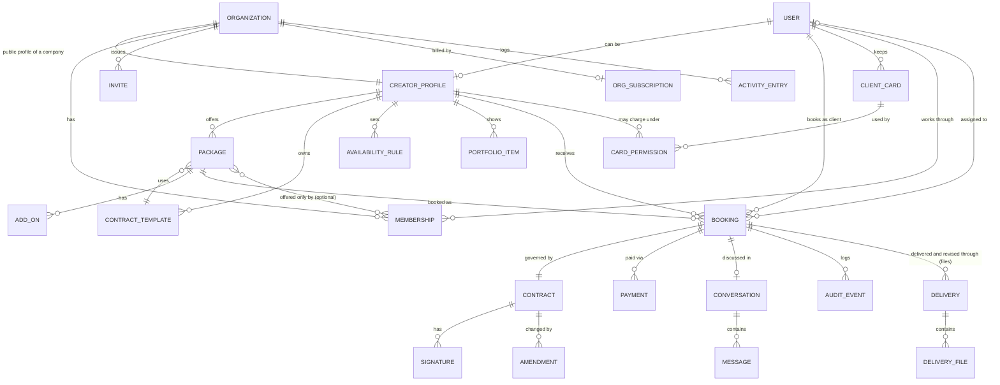
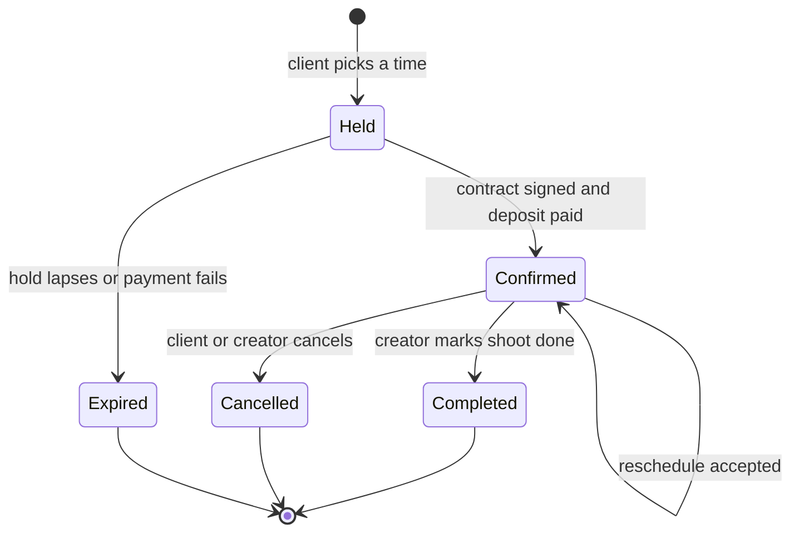

# Product Spec: Booking with Built-in Contracts for Creators

**Status:** Draft v0.5 · 2026-10-25 · Product name: *Slate Pro*
**Platform:** iOS and iPadOS first (SwiftUI). A lightweight web booking page for clients.
**Changes in v0.2:** two account types, Individual and Company (sections 2, 4.1 to 4.4, 5.4, 6, 7, 8.7 to 8.11, 9, 10, 12, 13). Team accounts moved from "Later" into scope.
**Changes in v0.3:** Slate Files, hosted delivery of photos and videos with storage in the plan, a 30-day window, previews before payment and originals after, and free revisions once paid (sections 2, 4.4, 5.1, 5.2, 5.5, 7, 8.6, 8.12, 9, 10, 11, 12, 13).
**Changes in v0.4:** client accounts, a free third account type with Sign in with Apple or an emailed code, and booking links that lead straight to one, search for creators, and a featured-creators grid on a client's Home (sections 2, 4, 4.1, 5.2, 8.13, 9, 10, 13).
**Changes in v0.5:** cards on file on a client's Profile, and a creator's permission to charge a saved card for the balance of a booking (sections 2, 5.2, 7, 8.3, 8.14, 9, 12, 13).

---

## 1. Summary

An iOS app for videographers, photographers and freelance creators to sell their services and get booked, in the way Booksy does for salons. The difference is that **every booking produces a signed contract**. Clients can't book without agreeing to the creator's terms, and creators never chase signatures, deposits or "what did we agree?" threads.

**Positioning:** Booksy handles scheduling and payment for appointments. Creators who shoot weddings, events, brand work or portraits have a different problem. Each job has scope, deliverables, usage rights, travel, a deposit and cancellation terms, and those usually live in a PDF, a DM thread and a payment link. This app puts them in one flow.

**The promise:**
- *Creator:* share one link and receive bookings that are already signed and deposit-paid.
- *Client:* pick a package and a time, then sign and pay in three taps or fewer.

## 2. Decisions locked and assumptions

Decisions made with the product owner:

| # | Decision | Consequence |
|---|---|---|
| D1 | **Design rules** are the Apple-native rules (section 3). No CLAUDE.md exists in the repo. | Section 3 is normative. A CLAUDE.md should be created from it (see section 13). |
| D2 | **Creator booking link first.** There is no marketplace or search in the MVP. | No cold-start problem. The creator brings their own audience. Discovery is a later phase. |
| D3 | **Contracts = templates plus in-app e-signature.** The creator attaches a template to each package. The client reviews and signs inside the booking flow. We store a timestamped audit trail and a PDF. | We build template, signing and PDF/audit infrastructure ourselves. Legal review is required before launch. |
| D4 | **Payments = deposit at booking** via Apple Pay and Stripe Connect. The balance is due later. | A booking is confirmed only when the contract is signed and the deposit is paid. |
| D5 | **Two account types**, chosen after Sign in with Apple: **Individual** ("Just me") and **Company** ("My company"). An Individual can upgrade to a Company later without losing profile, services, bookings or contracts. | Section 4.1. Team accounts are no longer deferred. |
| D6 | **Company seats are billed with Stripe Billing, per seat.** The company plan is bought and managed on the web in a system sheet. No In-App Purchase. Individual accounts stay free. | App Review risk R9. Billing state lives on the organization (section 7). |
| D7 | **The 10-seat minimum is a billing floor,** not a member count. A company can have fewer than 10 members and is billed for at least 10 seats. The maximum is 250. Both numbers are config values (section 4.4). | Changing them is a config change, not a code change. |
| D8 | **On upgrade, services move to the company, signed work stays with the person.** Services, packages and contract templates become company-owned. The person's availability stays on their own calendar, which becomes their member calendar. Executed contracts and their bookings stay with the person as the contracting party, because they are immutable and the client agreed to that person. | Section 8.7. |
| D9 | **Company payments go to the company's own Stripe Connect account.** Optional member payouts are a **split ledger** (a per-member share recorded on each booking for reports and payroll). Slate Pro makes no automatic transfers to members. | Section 4.3. Stripe transfers to members are Later. |
| D10 | **Company defaults:** bookings are auto-assigned unless an Admin switches the company to manual assignment. Invites are single-use links shared through the system share sheet (no server-sent email yet). Contracts are countersigned automatically by a **designated signer**. | Sections 6, 8.8, 8.9. |
| D11 | **Slate Pro hosts the delivery files.** A creator delivers photos and videos inside the app, and the client views and saves them there. Delivery by an external link stays as a fallback, for very large files or a creator who prefers their own host. | Section 5.5 and flow 8.12. Slate Pro becomes a host of people's files, so terms of use, reporting and takedown are launch requirements (R16). |
| D12 | **Storage comes with the plan, and delivered files expire 30 days after delivery.** An Individual account has a storage allowance. A company's allowance grows with its billed seats. Files that are not saved in time are deleted. | Config values in 4.4. Expiry is final, and the app says so before and after delivery (R17). |
| D13 | **Previews before payment, originals after.** As soon as files are delivered the client sees reduced, watermarked previews. They cannot save or share a preview. The originals can be saved only when nothing is owed on the booking. | The database decides this on every request, never the app. For hosted files the balance becomes payable at delivery (8.12). |
| D14 | **Photos and videos both.** | Large video is the hard part (R15, R19). |
| D15 | **Revisions are a second form of delivery, with no paywall.** After the client has paid, the creator can send revised or extra files that the client can save at once, with no payment step. | Section 5.5 and flow 8.12. A revision cannot exist while a balance is owed, so it is never a way around payment (R21). |
| D16 | **A third account type: Client.** The choice screen after sign-in has three cards: *Just me*, *My company* and *I'm booking a creator*. A client is free, has no profile, and can search for creators, book, sign, pay, message and keep contracts, payments and files. A client account is for booking only: there is no way to start selling from inside it, so someone who wants to sell uses a different email. | Sections 4.1 and 8.13. |
| D17 | **Two ways into a client account, both free: Sign in with Apple, or an emailed code.** The code is the guest account: no password, and entering the same email later signs the person back in, so a repeat client keeps their bookings. A name is asked once. | Section 8.13. Supabase email codes need the Email provider turned on and a real mail sender (README). |
| D18 | **A booking link makes a client.** Someone who opens a booking link and has no account is taken to sign in as a client, with no type to choose, and lands on the creator's page afterwards. | Section 8.13. A web page for people without the app is still Q4. |
| D19 | **Clients can search for creators** by name, link name or what they shoot (weddings, portraits). Only creators with a published package are found, so every result can be booked. There is still no marketplace: no categories to browse, no ranking, no ratings sort. | Section 8.13. Reverses part of D2 for search only (section 10). |
| D20 | **A featured-creators grid on a client's Home**, under the search field and in the manner of an explore page: a picture for each creator a client could book, with their name, rating and starting price, a row of specialties to narrow it, and, once the client has said where they are, how far away each creator is. **It is based on location:** creators who work where the client is come first. It is worked out, not paid for and not hand-picked, so it is the same for everyone and nobody can buy a place in it. Twelve at a time. | Section 8.13 and `featured_creators()` / `FeaturedRules`. Still no marketplace: no sort options, no paid placement, no categories page (section 10). Q38 asks whether creators may opt out. |
| D21 | **A client says where they are by choosing a city or by letting the phone find theirs.** Either way only a city-level place (rounded to about a kilometre) is kept: on the phone, per person, and nowhere else. It is sent to the database only as an argument when the grid is asked for, and not stored there. Using location is always optional: without a place the grid is ordered by quality alone. | Section 8.13, R22, `GeoPoint` / `ClientPlace`. Asks for the "while using the app" permission, with an approximate position, and only when the person taps Use my location. |
| D22 | **A client can keep cards on file, on their Profile.** A card is added on Stripe's own secure page; Slate Pro never sees the number, the expiry or the security code. Slate Pro keeps only a reference to the card at Stripe and what is needed to show it ("Visa ending 4242, expires 08/28"). Up to five cards. Removing a card removes it at Stripe too and ends every permission that used it. | Section 8.14 and `…_cards_on_file.sql`. Keeps Slate Pro out of the heaviest card-security rules (R24). Q47 asks about saving an Apple Pay card. |
| D23 | **A creator can charge a saved card only if the client has allowed that creator, and then only for the balance of a booking.** The client chooses, creator by creator, which card, and can stop it at any moment without anyone's agreement. The permission covers the remaining balance of the client's bookings with that creator, never more, and nothing else: no fees, no extras, no deposit. It does not change *when* the balance is payable (D13): not until the client has confirmed they have their files. A creator sees that a card is allowed and its brand, never the number. | Section 8.14, R23, R25. Q42 to Q44 are the "what about" questions (deposits, late fees, automatic payment). |
| D24 | **A charge to a saved card goes through the same rules as any balance payment.** The database works out the amount, Stripe's signed webhook is the only thing that records money as received, and the client is told at once with the usual "payment received" notice. If the card is declined, or the bank wants the client to approve it, nothing is recorded as paid, the creator is told, and the client pays in the app as before. There is no automatic retry. | Section 8.14. A decline notice to the client is Q45. |
| D25 | **Who may charge:** whoever can manage that booking: a person selling alone, for their own bookings; at a company, the Owner, Admin and Manager, and the Creator the booking is assigned to. A Viewer cannot. | The same access as marking a booking delivered or cancelling it (`provider_access(…, 'manage')`), so no new permission exists to keep in step across three places. |

Assumptions, open to change (section 13):

- **A1.** The MVP launches in one country (US, USD) under ESIGN/UETA.
- **A2.** Clients can book without installing the app. The booking link opens the app if installed and otherwise a minimal web page. An App Clip is the alternative to evaluate (section 13, Q4).
- **A3.** Minimum OS is iOS 17. Newer system looks (e.g. Liquid Glass) come from using system components, not custom chrome.
- **A4.** Instant booking only. A creator-approval "request to book" mode comes later.
- **A5.** The backend is required (contracts, payments, web link, email) and is built or bought separately from this spec.
- **A6.** One person can belong to several companies and can own more than one. Each membership has its own role. The account switcher (section 9) moves between them.
- **A7.** A team member needs a person profile (display name, handle, avatar, bio, specialties). It is created in the join flow if they have none, and it is also their member sub-profile on the company page. Their availability and calendar are attached to it.
- **A8.** A company is US and USD like everyone else (A1). One currency per company.
- **A9.** A company has exactly one Owner. Ownership can be transferred, and an Owner must transfer or delete the company before deleting their own account.
- **A10.** Invite links expire after 7 days (config value). The link is the credential. The email typed on an invite is only a label and an address for the Mail sheet, because Hide My Email relay addresses make matching unreliable (R6).
- **A11.** The 30 days run from the moment the creator taps Deliver. Paying does not restart them and saving a file does not shorten them. On the last day the previews and the originals are deleted together (Q24).
- **A12.** A booking has one delivery and any number of revisions (D15). The creator can add files to a delivery or a revision until it expires, and added files expire with it.
- **A13.** Previews are made on the creator's phone (reduced and watermarked) and uploaded beside each original. The server decides who may see what and caps how big a preview may be, but does not look at the pixels. Making previews on the server is Later (R18).
- **A14.** Saving is file by file, or "Save all" as a queue of downloads. There are no zip files in the first version.

## 3. Design rules (normative)

These come from the product owner's brief and apply to every screen.

| Rule | How it applies here |
|---|---|
| Swift and SwiftUI, iOS/iPadOS first, follow Apple's HIG | No custom navigation paradigms. The web booking page mirrors the same visual language (system font stack, `prefers-color-scheme`). |
| System fonts (SF Pro), Dynamic Type, SF Symbols, system colors | Light and Dark Mode come for free. Contracts and booking screens must stay usable at the largest accessibility text sizes. |
| Native patterns: `NavigationStack`, `TabView`, sheets with detents, swipe actions, pull to refresh, context menus | Tabs: **Home, Bookings, Services, Messages, Profile**. The booking flow is a sheet with `medium` and `large` detents. Bookings and messages use swipe actions. Packages, bookings and contracts use context menus. Lists support pull to refresh. |
| Generous whitespace, rounded cards, subtle materials, spring animations, haptics on key actions | Haptics: slot selected, contract signed, payment succeeded, booking cancelled. Animations respect Reduce Motion. |
| Sign in with Apple, Apple Pay, EventKit, push, widgets | See sections 5 and 8. |
| Accessibility first: VoiceOver labels, contrast, 44pt targets | A typed signature is the default so signing never depends on drawing precision. A drawn signature always has a typed alternative. Contract clauses are exposed as headings for VoiceOver. The PDF is tagged. |
| **Booking takes 3 taps or fewer** | Defined precisely below. |

**The 3-tap rule, defined.** Taps are counted from the tap that opens the booking sheet to the tap that confirms. System authentication (Face ID, side-button confirmation for Apple Pay) and typing don't count as taps.

| Path | Taps | Notes |
|---|---|---|
| Choose package → choose time → **Sign & pay deposit** | **3** | The earliest slot is preselected, so accepting it makes this 2. |
| "Book again" from Home → **Sign & pay deposit** | **2** | Same package, earliest slot preselected. |
| Add-ons, a different day, or editing the signing name | +1 each | Optional and opt-in. The "Soonest available" chips show the next several slots across days, so a different day is rarely needed. |
| **Exceptions** | >3 | (a) First-time web guests must verify an email code. (b) Creators can require a drawn signature or a full read-through on high-value packages. Both are documented exceptions, and each must be justified in the design review. |

Contracts and 3 taps seem to conflict, and the design resolves it this way. The contract is *summarised* in a key-terms card inside the booking sheet (what, when, where, price, deposit, balance due date, cancellation terms, usage rights, delivery date). The full text is one tap away. The primary button is labelled **"Sign & pay $X deposit"**. Next to it sits the signer's name (prefilled from their Apple ID) and a consent line: *"By tapping, I agree to the contract and sign it electronically."* Whether this is enough for enforceability is a legal question (section 12, R1).

## 4. Roles and account types

One account (Sign in with Apple) can hold both roles. A photographer can hire a videographer. The role is a capability on the account, switched from Profile. Section 4.1 adds a second, separate axis: whether the person sells as an **Individual** or as part of a **Company**.

| | **Creator** | **Client** |
|---|---|---|
| Who | Videographer, photographer, freelance creator who sells packages | A person or business booking a creator (couples, event hosts, brands, agencies) |
| Identity | Sign in with Apple, then creator onboarding (legal name, Stripe Connect) | Sign in with Apple, or an emailed one-time code (a guest account with no password, which also works for a repeat client). Free. A client can become a creator later. |
| Surfaces | iOS app only in the MVP | iOS app or web booking page |
| Core jobs | Set up packages, contracts and availability. Share the link. Get paid. Manage bookings and changes. | Pick a package and time. Understand the terms. Sign and pay. Keep the contract. Reschedule or cancel. |

Out of the MVP: an internal support/admin role beyond the console below. The MVP does include a **minimal internal console** for support (view a booking, contract and audit log, void a contract, refund). It isn't customer-facing. Studio and team accounts are covered by section 4.1 onward.

**Permissions at a glance (Individual creators and clients)**

| Capability | Creator | Client |
|---|---|---|
| Create and edit packages, templates, availability | Yes | No |
| Book a package | Yes (as a client of another creator) | Yes |
| View a booking and its contract | Own bookings | Own bookings |
| Cancel a booking | Yes (full refund to client) | Yes (refund per policy) |
| Propose a reschedule | Yes | Yes (the other party accepts) |
| Message in a booking thread | Yes | Yes |
| Edit a signed contract | No, only amendments accepted by both parties | No |

### 4.1 Account types

A person picks an account type in onboarding, right after signing in. The choice screen is three cards on a plain grouped background: **Just me** (an individual freelancer), **My company** (a business or team, 10 or more people) and **I'm booking a creator** (a client). The screen also has a third card, **I'm booking a creator**, for a client (D16). A client account is only for booking, so it has no way to start selling. A person who arrives from a booking link doesn't see the screen at all (D18).

| | **Individual ("Just me")** | **Company ("My company")** |
|---|---|---|
| Who owns the profile, services, calendar, contracts and payouts | The person | The **Organization**. People work under it through a **Membership** with a role. |
| Public booking link | `handle` of the person | `handle` of the company, plus an optional link per bookable team member |
| Contracts are made with | The person (their legal name) | The company (its legal name), countersigned by a designated signer |
| Money goes to | The person's Stripe Connect account | The company's own Stripe Connect account |
| Calendar | One calendar | One calendar **per member**, with a team view |
| Cost | Free | Per seat, billed with Stripe Billing (section 4.4) |

**Upgrade.** An Individual can become a Company from Profile at any time (flow in 8.7). Nothing is lost: services, packages and templates move to the new organization, while the personal profile, portfolio, availability and every existing booking and contract stay where they were and remain visible. Executed contracts and their bookings stay with the person (D8). The person becomes the Owner and their personal profile becomes their member sub-profile. The company profile starts prefilled from it (bio, location, specialties) and builds its own portfolio. A downgrade back to Individual is possible only when the Owner is the sole member (8.11).

**A person can hold both.** Someone can have a personal Individual presence and also be a member of one or more companies (A6). Each shows as an account in the switcher (section 9). A booking always belongs to exactly one of them.

### 4.2 Company roles

Five roles. "Creator" here means a team member who shoots and is distinct from the account-level creator capability in section 4. Each person has one role per company.

| Role | Intent |
|---|---|
| **Owner** | Billing, deleting the company, and everything else. Exactly one (A9). |
| **Admin** | Manages the team, services, pricing and contract templates. |
| **Manager** | Assigns and manages bookings and views reports. |
| **Creator** | Manages their own calendar and their assigned bookings. |
| **Viewer** | Read only. |

### 4.3 Permissions (normative, enforced on the backend)

Every row is a permission key. The same matrix is implemented in SQL (`org_role_allows`) and in Swift (`OrgPermission`), and a shared fixture (`team_permissions.json`) is checked by both test suites. The app hides what a role can't do, but the **backend refuses it regardless of what the app sends** (row level security and function checks), and tests exercise each refusal.

| Permission | Owner | Admin | Manager | Creator | Viewer |
|---|---|---|---|---|---|
| `company.delete` delete the company | ✓ | | | | |
| `billing.manage` plan, seats, invoices | ✓ | | | | |
| `payments.connect` company Stripe Connect account | ✓ | | | | |
| `payouts.split` set member shares in the split ledger | ✓ | | | | |
| `company.edit` company profile, portfolio, settings, assignment mode | ✓ | ✓ | | | |
| `team.invite` create and revoke invites | ✓ | ✓ | | | |
| `team.manage` change roles, remove members, member listing flags | ✓ | ✓ | | | |
| `services.manage` shared services, packages, pricing, add-ons, per-member services | ✓ | ✓ | | | |
| `templates.manage` contract templates | ✓ | ✓ | | | |
| `signer.designate` choose the designated signer | ✓ | ✓ | | | |
| `activity.view` the activity log | ✓ | ✓ | | | |
| `bookings.assign` assign or reassign a booking | ✓ | ✓ | ✓ | | |
| `bookings.manage` act on any booking (cancel, reschedule, complete, deliver) | ✓ | ✓ | ✓ | | |
| `bookings.view_all` see every booking and its contract | ✓ | ✓ | ✓ | | ✓ |
| `reports.view` earnings and booking reports | ✓ | ✓ | ✓ | | ✓ |
| `bookings.manage_assigned` act on bookings assigned to me | ✓ | ✓ | ✓ | ✓ | |
| `calendar.manage_own` my availability and busy times | ✓ | ✓ | ✓ | ✓ | |
| `calendar.view_team` the team calendar | ✓ | ✓ | ✓ | ✓ | ✓ |
| `team.view` the member list | ✓ | ✓ | ✓ | ✓ | ✓ |

Rules the matrix can't express:

- **Who can change whom.** The Owner can change anyone else. An Admin can invite, change and remove Managers, Creators and Viewers, and can't touch the Owner or other Admins. Only the Owner promotes someone to Admin or demotes an Admin. Nobody changes their own role. Nobody but the Owner can transfer ownership.
- **Bookable members.** Owner, Admin, Manager and Creator can be assigned bookings. A Viewer can't. A member can also be switched off as bookable (for example a Manager who doesn't shoot).
- **Authorised signers.** The designated signer is an Owner or an Admin by default. The Owner can allow Managers too (a company setting). A role not on that list can't be designated.
- **Last Owner.** The Owner can't leave, be removed or be demoted. They transfer ownership first.
- **Removed members** lose access immediately. Their assigned future bookings go back to the unassigned queue for a Manager (8.10). Their personal profile and anything they own personally is untouched.
- **A lapsed plan** (billing canceled or unpaid past the grace period) makes the company read only for everyone except the Owner, who can fix billing. Existing bookings, contracts and history stay readable (R7).

### 4.4 Config values

Kept in one place per layer (`app_settings` in SQL, `TeamConfig` in Swift) so they can change without touching rules code.

| Key | Default | Meaning |
|---|---|---|
| `seats.minimum` | 10 | Billing floor: a company is billed for at least this many seats. |
| `seats.maximum` | 250 | Most members a company can have, counting pending invites. |
| `invites.expiry_days` | 7 | Lifetime of an invite link. |
| `billing.grace_days` | 7 | How long a company stays usable after a failed seat payment before it becomes read only. |
| `files.retention_days` | 30 | How long a delivery stays available, counted from the moment it is delivered. |
| `files.draft_days` | 7 | How long files that were uploaded but never delivered are kept. |
| `files.warn_days` | 7, 1 | Reminders to the client, in days before expiry, while anything is unsaved. |
| `files.quota_gb.individual` | 25 | Storage allowance of an Individual account. Placeholder (Q25). |
| `files.quota_gb.per_seat` | 25 | Allowance added per **billed** seat for a company, shared across the company. Placeholder (Q25). |
| `files.max_photo_mb` | 100 | Largest photo. |
| `files.max_video_gb` | 4 | Largest video. |
| `files.max_files` | 1000 | Most files in one delivery. |
| `files.preview_photo_max_mb` | 5 | Largest preview of a photo. |
| `files.preview_video_max_mb` | 150 | Largest preview of a video. |
| `files.url_minutes` | 15 | How long a download link works once the app has asked for it. |

Seat accounting: **seats used** = active members. **Seats billed** = `max(seats.minimum, seats used)`. Pending invites are not billed until accepted, but count toward `seats.maximum`. Seat additions are prorated by Stripe immediately. Reductions take effect at the next renewal, and the screen says exactly when and what changes before the Owner confirms.

Storage accounting: **storage used** = the bytes of every file, original and preview, that is reserved, uploading or ready and not yet expired or removed, for the account on screen. A company's allowance is `files.quota_gb.per_seat` times its **billed** seats and is shared by everyone in it. Space is reserved when an upload starts and handed back if the upload is not finished within 24 hours. An upload that would go over the allowance is refused before any bytes are sent, and the message says how much is used and what the allowance is. Space comes back when files expire or the creator removes them. A lapsed company plan (4.3) keeps its files until they expire and takes no new uploads.

## 5. Core features

Legend: **MVP** = in the first release. **Later** = post-MVP.

### 5.1 Creator

| Feature | Detail | Phase |
|---|---|---|
| Onboarding | Sign in with Apple, then business name, handle, legal name and address (needed in contracts), categories, then Stripe Connect Express onboarding. Target: link live in under 10 minutes. | MVP |
| Profile and portfolio | Bio, location and travel radius, up to 12 images, external video links (YouTube/Vimeo). | MVP |
| Packages | Name, description, duration, fixed price, deposit (percent or fixed), deliverables list, delivery turnaround, location type (on-location, studio, remote), travel fee, add-ons, cancellation policy, attached contract template. | MVP |
| Contract templates | Starter templates plus a clause editor with merge fields. Versioned. Creator authorises auto-countersign at publish. See section 6. | MVP |
| Availability | Weekly hours, date exceptions, buffer before and after, minimum notice, maximum advance, max bookings per day. | MVP |
| Booking link | `handle` URL and QR code, shared with the system share sheet. Opens the app if installed, else the web page. | MVP |
| Bookings dashboard | Upcoming, past, needs-attention (balance overdue, change requested). Swipe actions and context menus. | MVP |
| Changes | Accept or decline a reschedule. Cancel with a refund. | MVP |
| Messages | One thread per booking. System messages for events. | MVP |
| Earnings | Read-only summary of payments and Stripe payouts. | MVP |
| Calendar | Confirmed bookings added to Apple Calendar via EventKit. | MVP |
| Widget | "Next shoot": small, medium and lock-screen accessory sizes. | MVP |
| Import busy times from personal calendars | Avoid double-booking against non-app events. | Later (fast follow) |
| Request-to-book, custom quotes and proposals | For bespoke jobs. | Later |
| Second shooters, team accounts | Moved into scope as Company accounts, section 5.4. | See 5.4 |
| Client file delivery | Photos and videos delivered, previewed and saved in the app (Slate Files, section 5.5). | MVP |

### 5.2 Client

| Feature | Detail | Phase |
|---|---|---|
| Book from a link | Package, optional add-ons, time, key terms, sign and pay. | MVP |
| Sign in | Sign in with Apple, or an emailed one-time code in the app and on the web. Both make a free client account (8.13). | MVP |
| Pay deposit | Apple Pay (iOS and Safari). Card fallback on web through Stripe. | MVP |
| My bookings | Status, contract, payments, next steps. | MVP |
| Pay balance | One-tap Apple Pay from a reminder, due N days before the shoot (default 7). | MVP |
| Cards on file | Save cards on Stripe's page, see them as "Visa ending 4242", remove them, and allow a creator to charge the balance of their bookings to one (8.14). | MVP |
| Change or cancel | Reschedule request. Cancel with refund shown per policy *before* confirming. | MVP |
| Contract access | Signed PDF in the booking, shareable from the system share sheet. Emailed to both parties. | MVP |
| Receive files | Preview the delivered photos and videos at once, pay the balance to unlock them, save them to Photos or Files before the window ends. Later revisions arrive the same way and are free (5.5, 8.12). | MVP |
| Messages | Booking-scoped. | MVP |
| Calendar, reminders, widget | EventKit event with an alarm. Push at 24 h and 1 h. | MVP |
| Saved creators and rebook | The client's **Services** tab shows creators they've booked, with their packages. | MVP |
| Reviews and ratings, discovery and search | | Later |

### 5.3 Platform

Backend API, Stripe Connect integration, PDF generation, append-only audit log, transactional email, APNs, universal links, and the minimal support console.

### 5.4 Company accounts

Everything in 5.1 applies to a company, owned by the organization instead of a person. These are the additions.

| Feature | Detail | Phase |
|---|---|---|
| Account type choice | Two cards after Sign in with Apple: Just me, My company. | MVP |
| Upgrade to Company | From Profile, keeps profile, services, bookings and contracts (D8). | MVP |
| Company profile | Name, logo, bio, portfolio (up to 12 items), location, handle, legal name and address for contracts. | MVP |
| Team member sub-profiles | Each member's person profile (name, avatar, bio, specialties) plus a title and a "show on company page" flag. | MVP |
| Seats | Billing floor and maximum from config (section 4.4). | MVP |
| Invites | Single-use link, shared with the system share sheet. Typing an email pre-addresses the Mail sheet. Revocable, expires. | MVP |
| Roles and permissions | Owner, Admin, Manager, Creator, Viewer, enforced on the backend (section 4.3). | MVP |
| Shared services | Company packages, add-ons, pricing and contract templates that Owner and Admin control. | MVP |
| Per-member services | A company service offered by only chosen members, so a client can book that person. | MVP |
| Book the company | The client picks a package and a time. The booking is assigned to a member (auto by default, or by a Manager). | MVP |
| Book a member | The client picks a person on the company page and books them directly. | MVP |
| Team calendar | Everyone's availability and bookings, filterable by member. A person is never double booked. | MVP |
| Company contracts | Made in the company's name, countersigned automatically by the designated signer. | MVP |
| Company payments | Deposits and balances go to the company's Stripe Connect account. | MVP |
| Member split ledger | Optional per-member share recorded on each booking, shown in reports. | MVP |
| Activity log | Who changed bookings, contracts, prices and team members. | MVP |
| Seat billing | Stripe Billing per seat, with upgrade, downgrade and remove-member flows. | MVP |
| Account switcher | Move between Personal and each company, from Profile. | MVP |
| Automatic Stripe transfers to members | Members connect their own account and shares are transferred. | Later |
| SSO, SCIM, audit export | Enterprise administration. | Later |
| Per-member public pages with their own packages that members create themselves | Members managing their own services. | Later |

### 5.5 Slate Files (hosted delivery)

A creator delivers the finished photos and videos inside Slate. The client sees previews at once, pays the balance, and then saves the originals. It works the same for an Individual and for a company; a company uses its shared allowance.

| Feature | Detail | Phase |
|---|---|---|
| Deliver in the app | Once the shoot has started, the creator adds photos and videos from Photos or the Files app to the booking and taps **Deliver**. | MVP |
| Background uploads | Uploads continue when the app is closed, resume after a drop in signal, and show progress and **Retry** per file. A large video asks before using cellular data. | MVP |
| Previews | Each file has a reduced, watermarked preview made on the creator's phone. The client sees previews as soon as files are delivered. A preview is view only: no Save, no Share. | MVP |
| Unlock on payment | Originals can be saved only when nothing is owed on the booking. The balance becomes payable at delivery (8.12). | MVP |
| Revisions | Once the client has paid, the creator can **Send a revision**: more files with a title ("Revision 2: colour corrections") and a note. The client can save them at once, with no payment step. Each revision has its own 30 days and its own saved count. | MVP |
| Saving | Per file to Photos or Files, or **Save all** as a queue of downloads that continues in the background. "Saved 12 of 48" is shown to the client and to the creator. | MVP |
| Expiry | Everything in a delivery is deleted 30 days after delivery. The client is reminded at 7 days and 1 day while anything is unsaved. The creator is told when it ends and how many files were saved. | MVP |
| Storage meter | "4.2 of 25 GB used" under Settings, for the account on screen (4.4). | MVP |
| Remove a file | The creator can remove a file at any time. It is recorded. | MVP |
| Report a file | Either person can report a file. Reports go to the support console (R16). | MVP |
| Link delivery | The existing delivery by external link stays, for very large files. It still needs Confirm receipt before the balance is payable. | MVP |
| Favourites, comments, public gallery links, zip downloads, print sales | Client gallery extras. | Later |
| Client revision requests, revisions included in a package | The client asks for a revision in a structured request, and a package says how many revisions it includes. Today a client asks in the conversation. | Later |
| Previews made on the server, video transcoding and streaming | Stronger previews and smoother video. | Later |
| Extend the window | A creator or client asks for more than 30 days. | Later |

**Rules (normative).**

- **Who can add, deliver and remove files:** the people who can share a delivery today, that is `bookings.manage`, or `bookings.manage_assigned` for a booking assigned to them (4.3). A Viewer sees no files, because client work is private. The client sees only the files of their own bookings.
- **When a preview can be opened:** by the booking's client from delivery until expiry, and by the creator side while the files exist.
- **When an original can be opened:** by the booking's client only after delivery, before expiry, and when **nothing is owed** (the balance is paid, or there was none). By the creator side while the files exist. Whether anything is owed comes from payments recorded by Stripe's signed webhook, like everything else about money, so the app cannot unlock a file.
- **Hosted delivery has no Confirm receipt step.** The previews are how the client checks the work, so the balance is payable at delivery, and the booking completes when the files are delivered and nothing is owed. The delivery screen shows how many photos and videos there are, so a client can tell it is the whole set. "Something's wrong" opens the conversation. Link delivery is unchanged.
- **One way for the first delivery.** The first delivery is by files or by link, and the choice is locked once the client has paid the balance or confirmed receipt. Revisions are always files, whichever way the first delivery was made.
- **Revisions have no paywall.** Once the first delivery has been made and nothing is owed, the creator can send a revision (more files, a title, a note) as often as needed, on a completed booking too. Nothing in a revision is locked, so it has no payment step and its originals can be saved at once. It is not a way around payment, because the backend refuses to create a revision while a balance is owed, and a creator has no switch to waive payment on a first delivery (R21, Q31). A revision has its own 30 days, uses the same allowance, and leaves earlier deliveries as they are. It is also the way to re-send files after a paid delivery has expired.
- **Notifications** use the existing Bookings switch: files delivered, revision sent, files about to expire (to the client), and a delivery or revision expired (to the creator). The conversation also gets a line for each delivery and each revision, written by the database like the others.
- **Expiry is final.** On the last day the originals and previews are deleted together. The booking, contract, payments and messages are untouched. What stays is the history of the delivery: names, kinds, sizes, and whether each file was saved.
- **After expiry** the client sees that the files have expired and who to ask. The creator can deliver again, which starts a new 30 days. If the balance is already paid, the client can save as soon as the new delivery is made.
- **Deleting an account** deletes the files it delivered. A client who deletes their account loses their access and nothing else.

**How it is built** (design notes, not a schema):

- **Private storage.** One private bucket. Object paths use lowercase UUIDs: owner, booking, file, then `original` or `preview`. Nothing is public.
- **Upload.** The app asks the backend to **reserve** a file. The backend checks permission, the caps and the allowance, records the file as uploading and returns the paths. The app then uploads with a resumable upload on a background session, preview first and original second, and asks the backend to **finalize**. Finalize reads the real size from storage, accepts the file, and deletes and rejects anything larger than was reserved or any preview over its cap. A reservation that is never finalized lapses after 24 hours.
- **Download.** The app asks for a short-lived signed link (`files.url_minutes`). The link is made under the caller's own access, so the database policy for the preview or the original decides, at that moment. A link cannot be made for an original that is still locked.
- **Expiry.** An Edge Function on a schedule, run like `send-push`, deletes the objects through the Storage API and marks the delivery expired. It is safe to run twice. Deleting database rows alone would not free the bytes.
- **Rules in two places.** The caps, the allowance, the unlock rule and the expiry date are one set of rules in Swift and SQL, with a shared fixture (`file_rules.json`) that both test suites read, like the other rules in this spec.
- **On a device with no server,** files are copied into the app's own folder, payment is the demo payment, and expiry uses the app's clock, so the whole flow can be tried and tested.

## 6. Contracts

This is the differentiator, so it gets its own section.

**Templates**
- Three **starter templates**: wedding or event, portrait or session, and commercial or brand. They are clause-based and editable.
- A template is an ordered list of clauses. Each clause has a title and body and can use **merge fields**: client name, event date, location, package name, price, deposit, balance due date, deliverables, delivery date, cancellation terms, usage rights, travel fee, overtime rate.
- Clauses are either editable or **system-locked**. Locked clauses include the e-sign consent and the parties block.
- Editing a template creates a new **version**. Existing bookings keep the version their client signed.
- Starter templates are not legal advice and are marked as such in the app.

**At booking**
1. The system merges the booking data into the package's template and produces an **immutable contract instance**: the rendered text, the template version, and a SHA-256 hash of the document.
2. The client sees the key-terms card and can open the full text.
3. The client signs with a **typed signature** (default, prefilled) or a **drawn signature** (creator option).
4. The creator's **countersignature** is applied automatically from their stored signature, under the authorisation they gave when publishing the template.
5. When the deposit succeeds, the contract becomes **executed** and the booking becomes **confirmed**.

**Company contracts.** When the provider is a company:

- The parties block names the **company** (its legal name) as provider. It doesn't name the assigned member: a booking can be reassigned after signing and a contract is never edited. The assigned member appears on the booking and on the key-terms card.
- The countersignature is applied automatically by the company's **designated signer**: a named Owner or Admin (or another allowed role, section 4.3) with a title, who authorised auto-countersign when the company published. The signature record stores the signer's name, title, user id and "on behalf of" the company. Every automatic countersignature appears in the activity log.
- Only a person with `signer.designate` can change the designated signer, and only for new contracts. Executed contracts keep the signer they had.
- The countersigner is **fixed when the client signs**. If the designated signer is removed or loses their role afterwards, a contract the client already signed is still completed by that person when the deposit arrives (they held the authority at that moment), while auto-countersign **stops** for new bookings: the company can't take any until a new signer is designated. Contracts are never signed in the name of someone who had no authority when the client signed.
- Upgrading from Individual never rewrites an executed contract (D8). Those contracts keep the person as provider.

**Signature record and audit trail** (per signer): signed name, method, consent-text version, timestamp, IP address, device and user agent, locale, email at signing, and how the identity was verified (Apple ID or email code). The executed PDF carries a **certificate page** with this data and the document hash.

**Ordering rule.** Signing and paying happen in one step. If payment fails or the hold lapses, the signature is voided, the contract never becomes executed, and the client is told. Money and a contract are never in a half-finished state that either party can rely on.

**Changes after signing.** Rescheduling, scope changes and cancellations produce an **amendment** that both parties must accept. The original contract is never edited. A cancellation records the outcome and the refund applied.

**Retention and deletion.** Account deletion is available in-app (App Store requirement). Executed contracts must be retained for legal reasons, so deletion removes personal data where the law allows and retains the contract and audit record. The retention period is an open question (Q10).

## 7. Data models

Entities, key fields and relationships. This is a conceptual model, not a schema.

**The owner field.** Services (packages and their templates), bookings, contracts and payments accounts all carry an **owner** that is either a person or an organization. It is stored as a reference to a **CreatorProfile**, and a profile has a `kind` of `person` or `company`. A person's profile id is their user id. A company's profile id is its organization id. So a foreign key keeps the owner real, and "who owns this" is one lookup (`kind`), not a loose pair of columns. Team access is never inferred from the owner id alone: every read and write goes through the membership and role checks in section 4.3.

| Entity | Key fields | Notes |
|---|---|---|
| **User** | id, Apple subject id (nullable for guests), email, email verified, display name, timezone, locale, roles (client always, creator optional), deleted at | Guest clients are Users created by email code and can be merged into an Apple ID later. Hide My Email relay addresses are supported (section 12, R6). |
| **CreatorProfile** | **kind (person or company)**, user id (null for a company), handle (unique), business name, legal name, legal address, bio, categories, base location and travel radius, currency, stripe account id, charges and payouts enabled, stored signature, published flag | Publishing requires charges enabled. A private preview link works earlier. For a company this row is the public page: name, logo, bio, portfolio and location. |
| **Organization** | id (equals its company profile id), legal name, legal address, created by, assignment mode (auto or manual), allowed signer roles, designated signer (user id, title), split ledger on or off, state (active, lapsed, closed), created at, closed at | The administrative record behind a company. One Owner (A9). |
| **Membership** | organization id, user id, role (owner, admin, manager, creator, viewer), title, listed on the company page, bookable, split share (basis points), joined at, removed at | One active row per person per company. Removing a member sets `removed at` so history keeps its meaning. |
| **Invite** | organization id, role, email (label only, optional), token hash, invited by, expires at, status (pending, accepted, revoked, expired), accepted by and at | The token is shown once, when the invite is created. Only its hash is stored. Single use. Never grants Owner. |
| **PackageMember** | package id, user id | Present only for a per-member service. No rows means every bookable member can take the package. |
| **OrgSubscription** | organization id, Stripe customer id, subscription id, status (none, trialing, active, past due, canceled), seats billed, seats scheduled for the next renewal, period end, grace until | Written from Stripe's signed webhook only, never by the app. |
| **ActivityEntry** | organization id, actor (user id and a name snapshot), action, entity type and id, summary, metadata, timestamp | Append only. Written by triggers on bookings, contracts, packages, memberships and the organization, so no code path can forget. It is the company-level counterpart of AuditEvent. |
| **PortfolioItem** | kind (image or video link), url, caption, order | Up to 12 per creator in the MVP. |
| **Package** | **owner (creator id)**, name, description, category, duration, price, deposit rule, deliverables, turnaround days, location type, travel fee, cancellation policy, buffer before and after, template id, status (draft, active, archived) | Booking stores a **snapshot** of the fields below, so later edits never change an existing booking. |
| **AddOn** | package id, name, price, extra minutes, description | Examples: extra hour, second shooter, drone, rush delivery. |
| **AvailabilityRule / Exception** | weekday, start and end, timezone; exception date, blocked or extra, window; settings: minimum notice, maximum advance, daily cap | |
| **CancellationPolicy** | name, rules (hours before → refund percent), applies to deposit and balance | MVP ships three presets: Flexible, Moderate, Strict. Custom policies come later. |
| **ContractTemplate** | **owner (creator id)** or system, title, category, version, clauses (title, body, locked), merge fields used, status, auto-countersign authorised at | Starter templates are system-owned and cloneable. |
| **Contract** | booking id, **owner (the provider party)**, template id and version, rendered body, document hash, parties (for a company: the company's legal name and the designated signer's id, name and title, fixed when the client signed), status (pending signature, executed, voided, superseded), executed at, PDF url, certificate url | Immutable once created. |
| **Signature** | contract id, signer role and user, signed name, method (typed, drawn, stored), consent-text version, signed at, IP, device, locale, email at signing, verification method | |
| **Amendment** | contract id, reason, change summary, proposed by, status (proposed, accepted, declined), accepted by both at | Used for reschedules and scope changes. |
| **Booking** | creator id (**the owner**), **assigned to (user id; equals the owner for an Individual)**, **requested member (true when the client chose that person)**, **assignee share (basis points, snapshot)**, client id, package id, **package snapshot**, add-ons snapshot, start and end, timezone, location, client brief, status, total, deposit, balance, balance due at, cancellation policy snapshot, contract id, created via (app, web), hold expires at, cancelled by and reason | Double booking is prevented per **assigned person**, not per owner, so a company's members work in parallel and each person is still never in two places. A company booking in manual-assignment mode has no assignee until a Manager assigns one (8.10). |
| **Payment** | booking id, kind (deposit, balance, refund, adjustment), amount, currency, platform fee, Stripe payment intent id, status, method (Apple Pay, card), paid at | Money is stored in minor units. |
| **Payout** (read-only mirror) | creator id (**the owner**), Stripe payout id, amount, status, arrival date | For the earnings screen. Stripe is the source of truth. A company's payouts are those of its own Connect account. |
| **Payment account** | creator id (**the owner**), Stripe account id, charges enabled, payouts enabled, details submitted | One per owner. A company's is separate from the personal one of any member. |
| **ClientCard** | user id, Stripe payment method id (never shown to the app), brand, last four digits, expiry month and year, added at | A reference, not a card: Stripe holds the number. Up to five per person. Readable only by its owner, and only these display columns. |
| **CardPermission** | client id, **owner (creator id)**, card id, consent version, allowed at | At most one per client and creator. Ends when the client stops it, the card is removed, or either account is deleted. Creators do not read this table; they are told only whether the booking in front of them has one (brand only). |
| **CardPermissionLog** | client id, creator id, action (allowed, stopped, card removed), card brand and last four at the time, consent version, at | Append only, kept for the client's own record and to show when an agreement was given if a charge is ever disputed. Removed with the account. |
| **Conversation / Message** | booking id, participants; sender, kind (text, system), body, sent at, read by | System messages are generated for booking, signing, payment and change events. |
| **Device / NotificationPreference** | user id, APNs token, environment; per-event toggles | |
| **Delivery** (files) | booking id, owner (the provider party, whose allowance is used), kind (delivery or revision), sequence (0 for the delivery, 1, 2 and so on for revisions), title and note (for a revision), state (draft, delivered, expired), delivered by and at, expires at, expired at, file count, bytes | One delivery and any number of revisions per booking (A12). A revision can be created only when nothing is owed. Written by backend functions only, never directly. The link delivery already on a booking is separate and unchanged. |
| **DeliveryFile** | delivery id, kind (photo or video), display name, content type, width and height, duration (video), original path and bytes, preview path and bytes, status (reserved, uploading, ready, removed, expired), created by, reserved at, saved by the client at (first save), removed at and by | Rows outlive the bytes: after expiry or removal they keep name, kind, size and whether the file was saved. The paths are cleared. |
| **AuditEvent** | entity type and id, actor, action, metadata, IP, timestamp | Append-only. Covers bookings, contracts, payments and changes. |

**Booking lifecycle**

- A **Held** booking reserves the slot for 10 minutes (proposed) so two clients can't book the same time.
- **Balance** is a payment state, not a booking state: `balance due`, `paid`, `overdue`. Overdue balances notify both parties and surface in the creator's needs-attention list.
- If the **creator cancels**, all payments are refunded in full automatically.
- If the **client cancels**, the refund follows the policy snapshot stored on the booking.

## 8. User flows

### 8.1 Creator onboarding and first link

1. Sign in with Apple.
2. Basics: business name, handle, categories, legal name and address (explained: "used in your contracts").
3. First package from a starter, with a starter contract template preselected. The creator can accept defaults and edit later.
4. Availability, prefilled Monday to Friday, 9:00 to 17:00, editable.
5. Stripe Connect Express onboarding in a system web authentication sheet. Stripe handles identity checks.
6. Authorise auto-countersign and store a signature.
7. Publish, then share the link and QR code through the system share sheet.

*Success:* a published link in under 10 minutes, excluding Stripe's own verification time. Until Stripe verification completes, the creator can use a private preview link only.

### 8.2 Client books (link to confirmed)

1. Client opens the link. If the app is installed it opens there. Otherwise the web page opens.
2. **Tap 1:** pick a package. The booking sheet opens with the earliest slot preselected.
3. **Tap 2:** pick a time from the "Soonest available" chips. Optional: add-ons, or "Other dates" for a full day and time picker.
4. The sheet shows the key-terms card, a "Read full contract" link, the signer name (prefilled), and the price breakdown (total, deposit now, balance later with due date).
5. **Tap 3:** **Sign & pay $X deposit**. Apple Pay authorises with Face ID or the side button.
6. Confirmation: haptic, animation, "Add to Calendar", signed PDF available, emails sent, creator notified.

*Failure paths:* payment fails (signature is voided, the client can retry within the hold), hold expires (offer the next slot), slot taken meanwhile (offer alternatives), Apple Pay unavailable (card fallback on web, "Add a card" prompt in the app).

### 8.3 Balance payment

1. N days before the shoot (default 7), push and email: "Balance of $X due."
2. Client taps the notification, then **Pay balance** with Apple Pay.
3. Creator sees "Paid in full". If still unpaid after the due date, both are notified and the booking appears under the creator's needs-attention list.
4. If the client has allowed the creator to charge a saved card (8.14), the creator can take the balance themselves, once it is payable.

### 8.4 Reschedule

1. Either party taps **Reschedule** (swipe action or context menu) and picks a new time inside the creator's availability.
2. The other party gets a notification with the proposed time and accepts or declines.
3. On acceptance, an amendment is recorded and signed by both parties, the calendar event and reminders update, and the signed amendment is appended to the contract PDF.

### 8.5 Cancel

1. Either party taps **Cancel**. A confirmation sheet shows the **exact refund** the policy produces *before* the final tap.
2. The booking is cancelled, the refund is issued, the contract is marked terminated with the outcome, and both parties are notified.
3. The calendar event and reminders are removed.

### 8.6 After the shoot

1. The creator marks the booking **Completed**.
2. If the balance is unpaid, the reminder flow continues. If it's paid, the booking moves to Past.
3. Both can still open the signed PDF at any time.
4. The creator delivers the final files, in the app (8.12) or by an external link. The client then pays the balance (8.3).

### 8.7 Choose a type, create or upgrade a company

**New account.** After Sign in with Apple, the choice screen shows **Just me** and **My company**. *Just me* continues with 8.1 unchanged. *My company* runs:

1. Company basics: company name, handle, categories, legal name and address ("used in your contracts").
2. You as the Owner: your name and photo. If you have no person profile one is created here (A7).
3. Plan: the seat floor, the per-seat price from Stripe, and a button that opens the Stripe checkout in a system web authentication sheet. Until the plan is active, the company can be set up but can't be published or invite anyone.
4. First shared service from a starter, with a starter template.
5. Designated signer: you, with your stored signature, and the auto-countersign authorisation.
6. Stripe Connect Express onboarding for the **company** account.
7. Publish and share the link and QR code.

**Upgrade an existing Individual** (Profile, "Upgrade to a company"):

1. A plain summary of what moves (services, packages, templates) and what stays (profile, portfolio, availability, every booking and contract, your Stripe account for existing bookings).
2. Company name, handle, legal name and address. Nothing is created yet.
3. **Upgrade.** One request creates the organization, the company profile, your Owner membership, and moves your services. If a booking of yours is in its 15-minute hold, the upgrade waits for it ("Try again in a few minutes") so a client never pays into a half-moved record.
4. The setup continues at step 3, 5, 6 and 7 of the new-account flow.

Balances on existing bookings are still paid to the personal Stripe account. Existing signed contracts still name the person.

### 8.8 Invite a team member

1. Settings, Team, **Invite** (needs `team.invite`). Pick a role (never Owner) and optionally type an email.
2. Slate Pro creates a single-use invite and opens the system share sheet with the link. If an email was typed, a pre-addressed Mail compose sheet is offered. The link is shown once. A lost link is replaced, not recovered: **Resend** revokes the old invite and makes a new one.
3. Pending invites are listed with swipe actions: **Revoke** and **Resend**. They expire after `invites.expiry_days`.
4. The invitee opens the link. The app opens, they sign in with Apple (their own login), see "Join Acme Films as Creator", add a name and handle if they have no profile, and tap **Join**.
5. An invite can't be created when the plan isn't active or the seat maximum would be exceeded, and the screen says which.

### 8.9 A client books the company or a member

1. The client opens the company link. The page shows the company profile, its services, and cards for the listed, bookable team members.
2. **Book the company.** Package, then time, then **Sign & pay**: the same 3 taps as 8.2. Times shown are those where **at least one eligible member is free** (a member is eligible when the package is offered by everyone or by them). In *auto* mode the booking is assigned immediately to the free eligible member with the fewest upcoming bookings (ties go to whoever joined first). In *manual* mode it is confirmed with no assignee and waits in the Managers' queue (8.10), and the times offered are limited so unassigned bookings never exceed the members who could take them.
3. **Book a member.** On a member card, **Book Dana** opens the same sheet with that member's packages and only that member's free times. The booking records that the client asked for that person.
4. The contract is in the **company's name** (section 6). The key-terms card shows the assigned member ("Your photographer: Dana") once there is one.

### 8.10 Assign, reassign and the team calendar

1. A **Needs assignment** list (Home and Bookings, for people with `bookings.assign`) holds bookings in manual mode and those returned by a removed member. Tapping one lists members who are free at that time. Busy members are shown disabled with the reason ("Busy 10:00 to 12:00"). Assigning notifies the member and the client.
2. **Reassign** is in the booking's context menu. If the client asked for that person, the sheet says so and asks for confirmation.
3. The **Team calendar** (Bookings, Team) shows a day or week with a filter chip per member. Availability is a light band and bookings are solid blocks. A Creator opens on their own calendar and can switch to the team.
4. The backend refuses an assignment that would put a person in two places, however the request arrived.

### 8.11 Seats, plan changes and leaving

- **Adding members.** Seats rise when an invite is accepted. The Owner sees "14 seats used, 14 billed, 250 maximum".
- **Removing a member** (swipe on the member row, or Settings, Team). The confirmation says what happens: their future bookings return to the assignment queue, they lose access immediately, and the seat is released at the next renewal (never below the floor). If they are the designated signer, it says auto-countersign will stop until a new signer is chosen.
- **Billing** (Owner): payment method, invoices and plan cancellation open in Stripe's hosted portal in a system sheet. A failed payment starts the grace period, and a banner tells the Owner and Admins.
- **Cancel the plan.** At the end of the period the company becomes read only (lapsed). The Owner can resubscribe or downgrade.
- **Downgrade to Individual.** Allowed when the Owner is the only member and nothing is held. The company's services move back to the person, the company page closes, and the company record is kept because executed contracts name it.
- **Leave a company.** Any member except the Owner can leave from Settings, Team. Their bookings return to the queue.
- **Delete a company** (Owner, with a confirmation that names what is retained). Executed contracts and the activity log are retained (R7).

### 8.12 Deliver files, preview, pay, save, expire

*The creator*

1. Once the shoot has started, the booking shows **Add files**. The creator picks photos and videos from Photos or the Files app. In a company, a member does this on a booking they may manage (4.3).
2. For each file the app first checks the caps and the allowance. A file that does not fit is refused before it uploads, with "4.2 of 25 GB used" and the choices: remove something, or deliver by link.
3. The app makes a reduced, watermarked preview of each file, uploads it, then uploads the original. Uploads continue in the background, so the creator can close the app. A file that fails shows **Retry**. Files that are never delivered are removed after 7 days.
4. When every file is ready, **Deliver** becomes available. Its confirmation says that {client} can see previews now, can save the originals once the balance is paid, and has until {date, 30 days on}; and that Slate Pro is not an archive, so the creator should keep their own copies. Delivering starts the 30 days, makes the balance payable, and notifies the client.

*The client*

5. The booking shows **Your files are ready**, "Available until {date}", and a grid of previews. A preview opens full screen, swipes between files, and plays video in place. It has no Save or Share.
6. If a balance is owed, the main action is **Pay balance to unlock downloads** (Apple Pay, 8.3). When Stripe reports the payment, the originals unlock. The app learns this from the booking, not from its own say-so. If nothing is owed, the originals are available at once.
7. **Save** puts a photo or video in Photos, or a file in Files. **Save all** queues every file as a background download with progress and **Cancel**. The screen shows "Saved 12 of 48". The creator sees the same count.
8. While anything is unsaved the client is reminded 7 days and 1 day before the end (config `files.warn_days`).

*The end*

9. On the last day a scheduled job deletes every original and preview in the delivery, hands the space back and marks it **Expired**. The creator is told how many files the client had saved. The history stays.
10. After expiry the client sees "These files expired on {date}. Ask {creator} to send them again." The creator can deliver again, which starts a new 30 days.
11. The creator can remove a single file at any time. Removal frees its space and is recorded in the activity log (company) or audit log.

*A revision, after payment*

12. When the first delivery has been made and nothing is owed, the booking shows **Send a revision**, including after the booking is completed. The creator adds files, gives the revision a title (it starts as "Revision 1", then "Revision 2") and an optional note, and taps **Send**. Nothing is locked, so the app makes only the small thumbnail the grid needs, without a watermark.
13. The client is notified: "{creator} sent revised files". The revision is listed under the delivery with its own "Available until {date}", a note, Save and Save all, and its own "Saved 3 of 14". There is no payment step.
14. The reminders at 7 days and 1 day apply to each revision on its own.
15. Earlier files are not touched. The delivery keeps its own date, and the client can still save from it until then. A revision adds to what the client has; to retire a superseded file, the creator removes it.
16. If the delivery has expired and the client had paid, a revision is how the creator sends the files again.

### 8.13 Client accounts and booking links

*Choosing to be a client*

1. After Sign in with Apple (or an emailed code), the choice screen shows three cards. **I'm booking a creator** takes the person straight into the app as a client: no profile, no payment details, nothing to set up. "Free, with or without a profile" is on the card.
2. A client sees the same five tabs with client meanings (section 9). They can search for creators, book, sign, pay, message, and keep their contracts, payments and files.
3. A client account has no "start selling" option. A person who later wants to sell signs in with a different email; being invited into a company (8.8) also works, and then the company shows in their account switcher.

*Signing in with an emailed code (the guest account)*

4. On the welcome screen, **Continue with email** asks for an email address and sends a six-digit code. The person types it in.
5. A new email asks for a name once (it goes in the contracts they sign). An email that has an account just signs in, so a repeat client gets their bookings back on any phone. There is no password to forget.
6. A code works for ten minutes and for one sign-in. Too many wrong tries ask for a new one.
7. On a device with no server, the code is shown on the screen (it is always 123456) so the flow can be tried.

*Finding a creator*

8. The **Creators** tab has a search field. Typing a name, a link name or what they shoot ("weddings", "real estate") lists matching creators, best match first: an exact link name, then names that start with the words, then the rest. At least two characters, and no more than 20 results.
9. With nothing typed, the tab offers the specialties as one-tap searches, and the creators the client has booked, with **Book again**.
10. Pasting a booking link into the field and pressing search opens that creator's page directly.
11. Only creators who have a published package are found, so every result can be booked. Searching needs an account.
12. Under the search field, a client's **Home** shows **Featured creators**: a grid of the creators they could book, each a tile with the first picture from their portfolio (a soft colour when they have none yet), their name, their average rating when they have reviews, "From $X", the lowest price among their published packages, and a line saying how far away they are ("4 mi away") or, with no place chosen, their city. Tapping a tile opens that creator's page, as a booking link does.
13. **Where the client is.** Until the client has chosen a place, a card under the heading says "See creators near you" with **Use my location** and **Choose a city** (and **Not now**, which hides the card). Use my location asks for permission once, finds the nearest city and keeps only that. Choose a city is the same search a creator uses for their home base. Beside the heading, a button shows the chosen city and opens a menu to change it, use the phone's location, or stop using a place. The place is kept per person on that phone.
14. **The order.** The same for everyone, and never paid for or hand-picked:
    1. with a place chosen, creators who **work there** come first: the client is within the distance the creator travels (their travel radius, 40 km if they haven't set one) of the city on their profile. With no place, nobody does, and this step changes nothing;
    2. creators with a portfolio piece before those without;
    3. a smoothed average rating, best first: (sum of ratings + 12) divided by (number of reviews + 3), so one five-star review doesn't outrank fifty good ones and a creator with no reviews yet isn't buried;
    4. more reviews, then more portfolio pieces;
    5. nearer first (a creator with no city last), then newest, then by id, so the order never shuffles.
    A client never sees their own account, or a company they work for. Distance is measured along the surface of the Earth between the client's place and the creator's city, not by road.
15. A row of specialties above the grid ("All", then Weddings, Portraits and so on) narrows it to creators who shoot that, in the same order. Up to twelve are shown.
16. On a device with no server there is nobody else to find, so the app starts with eight made-up sample creators in eight US cities (a profile, a published package with a contract, hours, a few drawn pictures and some reviews) so that search, the grid, location and booking can be tried end to end. With a server they never exist.
17. A creator shares their link (`slate://book/<handle>`, and the web link once there is a domain). Opening it in the app when signed in shows the creator's page over whatever the person was doing, as today.
18. Opening it with no account shows the welcome screen with "Sign in to see {creator}'s page", skips the account type choice (D18) and, after Apple or the emailed code, lands on the creator's page as a client.
14. A person who already has a creator account opens the page the same way, and books as themselves.

### 8.14 Cards on file

*Adding and removing cards*

1. **Profile ▸ Payment methods** lists the client's cards, each as "Visa ending 4242" with "Expires 08/28", or says there are none yet. A card past its expiry month is marked **Expired** and cannot be used.
2. **Add a card** opens Stripe's secure page in the in-app browser. The client types the card there; Slate Pro never receives it. When Stripe sends the person back, the card appears. Up to five cards; at five, Add a card says so.
3. **Remove** (swipe, or the card's menu) asks first. If creators are allowed to use that card the dialog names how many: "This also stops 2 creators from using it." Removing deletes the card at Stripe and then here.
4. On a device with no server, **Add a demo card** adds a pretend Visa so the rest can be tried. No card is read and no money moves.

*Allowing a creator*

5. Under the cards, **Creators who can charge a card** lists each permission (creator, card, date) with **Stop access**, which takes effect at once. **Allow a creator** lists the creators the client has booked (not cancelled) who have no permission yet. A booking's page offers the same: "Let {creator} charge the balance to my card", when the client has a card and has not already.
6. The agreement is a screen of plain words with a button: "{Creator} will be able to charge the remaining balance of your bookings with them to your Visa ending 4242, once you've confirmed you have your files. They can't charge anything else and they never see your card number. You can stop this at any time in Profile." **Allow {Creator}**. The wording has a version number, kept with the permission.
7. Allowing again with another card replaces the first. Only creators the client has actually booked can be allowed, and only with the client's own cards.

*Charging (the creator)*

8. On a booking whose balance is payable (the client has confirmed they have the files) and whose client has allowed the creator, whoever can manage that booking (D25) sees **Charge the saved card**: the amount, the card's brand and a confirmation ("Charge $1,200.00 to Alex's Visa? Alex is told straight away."). The amount is the balance, worked out by the database; it cannot be changed.
9. Before the balance is payable the same place says "{Client} has allowed you to charge their saved card once they confirm their files." Without a permission nothing is shown.
10. After the tap the app waits for Stripe to confirm, as for any payment, then shows "Paid in full". The client gets the usual payment notice and the conversation gets its "balance paid" line. A client who is part-way through paying with Apple Pay is not charged twice: the unfinished attempt is cancelled first.
11. If the card is declined, or the bank wants the client to approve the payment, the creator is told which, nothing is recorded as paid, and the balance stays due for the client to pay in the app. Slate Pro does not try again by itself.

*What the server checks, every time*

12. The person asking can manage the booking (D25); the client has a permission for this creator; the permission's card still exists and is not expired; the booking's balance is payable and unpaid (the same checks as `payment_prepare`). The permission is read at the moment of the charge, so stopping access stops any charge that has not started.
13. Deleting an account deletes its cards at Stripe and here; deleting a creator's profile ends the permissions given to them.

## 9. Screens and navigation

One `TabView` with five tabs, **role-aware**. Each tab owns a `NavigationStack`. Tab labels are the same for both roles.

| Tab | Creator | Client |
|---|---|---|
| **Home** | Today and this week, needs-attention list, link and QR shortcut, earnings snapshot | Next booking, "Book again", action items (balance due) |
| **Bookings** | Upcoming and Past, swipe actions (reschedule, cancel), detail with contract and payments | Same, plus pay balance |
| **Services** | Packages, contract templates, availability, portfolio | "Creators": those the client has booked or saved, with their packages |
| **Messages** | Booking threads, unread badge | Booking threads |
| **Profile** | Business profile, Stripe and payouts, calendar and notification settings, role switch, sign out, delete account | Account settings, payment methods, calendar and notification settings, role switch, sign out, delete account |

**Key surfaces:** the booking sheet (`medium` and `large` detents), the full-contract reader (`large` sheet), signature capture, the cancel confirmation (shows the refund), widgets, and push notification actions.

**Company accounts.** The five tabs and their labels don't change. What changes:

| Where | Change |
|---|---|
| **Account switcher** | *As built:* a small avatar button at the top left of Home, Bookings, Services and Profile (like the account button in Apple's apps) opens a sheet listing Personal and each company with the person's role, a checkmark on the current one, and "Upgrade to a company" or "Start a new company". Switching changes what every tab shows. The choice is remembered per device. |
| **Settings, Team** | *As built:* Settings is pushed from Profile ▸ ⋯. The Team section (for the company on screen; an individual sees "Upgrade to a company" there) has Members, Team calendar, Company settings, Billing (Owner), Activity (Owner, Admin) and My hours here, then Leave company. Rows a role can't use are hidden, not disabled. |
| **Members** | A list of people with role and title, with pending invites underneath. Swipe actions: **Remove** and **Role** (trailing), **Details** (leading), and a context menu with the same. Roles the actor can't set are not offered. Invites swipe to **Revoke** or get a **New link**. |
| **Home** | Adds a "Needs a person" card for people who can assign, and a Team calendar row for anyone who can see it (Viewers included). The plan's state shows as a banner. |
| **Bookings** | *As built:* a "Needs a person" section for people who can assign, and a **Team calendar** button in the toolbar that opens the calendar in a sheet (a day strip per person, a filter chip per member; 8.10). Rows show who has each booking. |
| **Services** | Company services with an "Offered by" line (everyone, or the chosen members). Templates are managed here by Owner and Admin. |
| **Profile** | The company page and its editor (Owner, Admin). The designated signer, the split ledger and going back to an individual account are under Settings ▸ Company settings; Stripe Connect for the company is under Services ▸ Payments (Owner). |

**Slate Files.** *Bookings ▸ a booking* gains a **Files** section. For the creator it has Add files, the progress and Retry of each upload, Deliver, and the delivery's state ("Delivered, available until Nov 22", "12 of 48 saved", "balance unpaid"). For the client it has a grid of previews, the expiry date, **Pay balance to unlock downloads**, then Save and Save all. Once the balance is paid the creator also sees **Send a revision**, and the client sees each revision listed under the delivery with its own expiry date and Save buttons, and no payment step. *Profile ▸ ⋯ ▸ Settings* gains a **Storage** row with the meter for the account on screen. It uses the system's photo picker, file importer, video player and background transfers, and the same design rules as the rest.

**Client accounts.** The five tabs and their labels stay, with these meanings for a client (an account with no creator profile and no company).

| Tab | A client sees |
|---|---|
| **Home** | A search field that opens Creators, the next booking, what needs doing (pay a balance, check the files, leave a review), **Book again** with the creators they have booked, and **Featured creators**: an explore grid, nearest first once they have chosen a city, with a row of specialties (8.13) |
| **Bookings** | The same list, with the pay, files, contract and cancel actions |
| **Creators** (in place of Services) | A search field for a name, a link name or what they shoot (a booking link pasted there opens that page), the specialties as one-tap searches, and the creators they have booked |
| **Messages** | The booking conversations, as today |
| **Profile** | Their name and email, **My contracts** (every signed contract and its PDF), **Payments and receipts** (what they have paid and been refunded), **Payment methods** (cards on file and the creators allowed to charge them), appearance, notifications, sign out and delete account. Nothing about selling. |

Each of these follows the design rules in section 3: system components, sheets with detents, swipe actions, context menus, and the same Dynamic Type and VoiceOver behaviour as everything else.

## 10. MVP scope

**Release goal.** A creator can set up and publish a bookable link in under 10 minutes. A client can book, sign and pay a deposit in three taps or fewer. Both receive a signed PDF. The creator receives the money.

**In the MVP:** everything marked **MVP** in section 5, plus the platform pieces in 5.3.

**Not in the MVP:**

| Area | Deferred |
|---|---|
| Discovery | A marketplace: a page of categories to browse, sort options, map view, paid or promoted placement. (Searching by name, link name or specialty is in, D19, and so is a featured-creators grid on a client's Home, D20.) |
| Booking modes | Request-to-book, custom quotes and proposals, recurring bookings, waitlists |
| Money | Installments and milestones, invoices beyond deposit and balance, tax, multi-currency, promo codes, creator subscriptions |
| Contracts | Third-party e-sign providers, model and property releases, usage-rights licensing add-ons, AI drafting |
| Teams | Automatic Stripe transfers to members, SSO and SCIM, audit export, members creating their own services. (Company accounts themselves are in scope, section 5.4.) |
| Integrations | Google Calendar or personal-calendar busy-time import |
| Files | Favourites and comments, public gallery links, zip downloads, print sales, previews made on the server, video transcoding and streaming, extending the 30 days, client revision requests and revisions included in a package (section 5.5) |
| Platform | Android, iPad-specific features beyond adaptive layout, Live Activities, in-app video calls |
| Support | Dispute and chargeback tooling beyond the minimal support console |

**Proposed success metrics** (targets to be confirmed; these are not commitments):

| Metric | Why it matters |
|---|---|
| Creators with a published link and at least one package, divided by sign-ups | Activation |
| Link views to confirmed bookings | Conversion |
| Median taps and time from package selection to confirmed | Validates the 3-tap rule |
| Share of confirmed bookings with an executed contract | Should be 100% by construction |
| Deposit success rate and balance on-time rate | Payment health |
| Creators paid out within the expected window | Trust |

**Suggested milestones** (no dates, because team size is unknown):

| Milestone | Outcome |
|---|---|
| M0 Foundations | Design system, backend skeleton, Sign in with Apple, Stripe Connect sandbox |
| M1 Creator setup | Profile, packages, availability, link and QR |
| M2 Booking and contract core | Booking sheet, template merge, signing, PDF and certificate, audit log |
| M3 Payments | Deposit with Apple Pay, balance, refunds, payout view |
| M4 Engagement | Messages, push and email, EventKit, widget |
| M5 Beta | Web booking page hardening, accessibility audit, legal review, TestFlight pilot with real creators, App Review preparation |
| M3b Company accounts | Organizations, memberships, roles enforced on the backend, shared services, assignment and team calendar, company contracts and payments, seat billing |
| M3c Slate Files | Hosted delivery: reserve, upload, preview, unlock on payment, revisions, save, expiry, storage meter, report a file |

## 11. Non-functional requirements

| Area | Requirement |
|---|---|
| Accessibility | VoiceOver labels and hints on every control. Dynamic Type through the largest accessibility sizes. 44pt minimum targets. Sufficient contrast in Light and Dark. Reduce Motion respected. Typed-signature alternative everywhere. Tagged PDFs. |
| Performance | Booking sheet is interactive in under 1 second after the tap. Upcoming bookings and signed contracts remain readable offline. |
| Security | Contracts are immutable and hash-verified. PDFs are served by short-lived signed URLs. Card data never touches our servers (Stripe and Apple Pay tokens). Audit log is append-only. |
| Team access | A role is checked in the database on every read and write (section 4.3), never trusted from the client. A removed member loses access on the next request. Invite tokens are single use, stored hashed and expire. The activity log is append only. |
| Files | One private bucket. Access only through short-lived signed links, each checked by the database at the moment it is made. An original is refused until nothing is owed. Uploads and downloads resume after an interruption and continue in the background. Expiry is idempotent. Storage used is computed in one place. Deleting an account deletes the files it delivered. |
| Privacy | Data minimisation. Accurate App Privacy details. EventKit access requested only when the user turns on calendar sync, with a plain explanation. In-app account deletion. |
| Reliability | Slot holds and payment-plus-contract confirmation must be atomic from the user's point of view (section 6, ordering rule). Idempotent payment calls. Reminders must still fire if a push is missed (local notifications as a backup). |
| Compliance | ESIGN/UETA for the launch market. Other markets (eIDAS, etc.) require separate review. |

## 12. Risks

| # | Risk | Mitigation |
|---|---|---|
| R1 | A one-tap "Sign & pay" may not satisfy enforceability in some jurisdictions or for high-value jobs. | Legal review before launch. Key-terms card plus an explicit consent line. Creators can require a drawn signature and full read-through (documented 3-tap exception). |
| R2 | Starter templates read as legal advice. | Clear "not legal advice" labelling. Counsel-reviewed starters. Creators own and edit their terms. |
| R3 | Stripe Connect onboarding is slow and can lose creators. | Preview link before verification. Set expectations in the flow. |
| R4 | App Review: payments for real-world services are generally outside In-App Purchase, but a creator **subscription** for digital features may not be. In-app account deletion is required. | Verify against the current App Review Guidelines before choosing the business model (Q3). |
| R5 | Double-booking against a creator's personal calendar. | Document the limitation in the MVP. Prioritise busy-time import as the first fast follow. |
| R6 | Sign in with Apple "Hide My Email" addresses only receive our email if our sending domain is registered with Apple's private email relay. | Register the sending domain before launch. Test delivery of the signed PDF to a relay address. |
| R7 | Contract retention conflicts with account deletion. | Retain the executed contract and audit record, remove personal data where the law allows, and say so in the deletion flow. |
| R8 | Chargebacks and disputes. | Contract plus audit certificate serve as evidence. Console supports manual handling in the MVP. |
| R9 | **Seat billing and App Review.** Guideline 3.1.3(c) lets an app sold directly to organizations take payment outside In-App Purchase, but consumer and single-user sales must use IAP. A one-person "company" is a grey area, though the 10-seat floor prices the plan for organizations and Individual accounts stay free. | Check the current guideline text before submission. The fallback is StoreKit seat bands (the option declined in D6). |
| R10 | **Cross-company data exposure.** A role check missed in one function, or an owner id trusted from the client, could show one company's bookings or contracts to another. | Permissions are enforced in the database (row level security and function checks), never from the client. Tests try every permission with every role, plus a member of another company, and assert the refusal. |
| R11 | **An upgrade leaves records split between a person and a company,** which can confuse accounting. | The upgrade summary says what moves and what stays. Records show whether they are Personal or the company's. The company's reports cover only the company. |
| R12 | **A removed designated signer halts bookings.** | Removing or demoting the signer is warned about before it happens, and the company shows a banner until a new signer is chosen. |
| R13 | **A company booking in manual mode can sit unassigned** while the client has paid. | Manual-mode capacity is limited (8.9) and unassigned bookings are on the Managers' needs-assignment list (Home and Bookings). *Not built:* a reminder before the shoot if it is still unassigned. |
| R14 | **Seat counts disagree between Slate Pro and Stripe.** | Seats billed are computed in one place from active members and the floor. Stripe's webhook is the record of what was charged, and the Owner's screen shows both. |
| R15 | **Storage and bandwidth cost grow with use, and video dominates both.** | An allowance per plan, the 30-day expiry and per-file and per-delivery caps, all config values (4.4). Measure real cost in the pilot before fixing the allowances (Q25). Moving downloads to a store without download fees is an option if bandwidth dominates. |
| R16 | **Hosting people's files makes Slate Pro responsible for what is on them** (App Review guideline 1.2, copyright takedowns, duties to report illegal content). | Files are private to the two people on a booking. Terms of use, a Report action on every file, a support process to remove content and suspend accounts, and a legal check of reporting duties before launch. Reporting and blocking are a prerequisite. |
| R17 | **Expiry deletes the only copy a client may have.** | The warning when delivering, the expiry date on every screen, reminders at 7 and 1 days, telling the creator which files were not saved, and saying plainly that Slate Pro is not an archive. Creators keep their own originals. |
| R18 | **A preview cannot be made impossible to copy, and the server cannot check a preview's pixels** because it is made on the creator's phone. | Previews are small and watermarked, so a screenshot is not worth taking. The server caps a preview's size and refuses one that is too large. Originals live on a different path that the database releases only after payment. Server-made previews are Later. |
| R19 | **Large uploads are unreliable on a phone** (signal, battery, the app closed, a full disk). | Resumable background uploads, per-file retry, a cellular prompt for large video, reservations that lapse after 24 hours. CI cannot exercise real uploads, so test on real devices in the pilot. |
| R20 | **An unpaid balance keeps files in storage** until the 30 days end. | The same 30-day clock. The creator sees "balance unpaid" on the delivery and can follow up in Messages. After expiry they can deliver again. |
| R21 | **A revision could become a way to hand over originals before payment,** or to pile up storage with repeated revisions. | The backend refuses to create a revision while a balance is owed, and there is no creator-side switch to waive payment. Revisions use the same allowance and the same 30-day expiry as everything else, so storage stays bounded. |
| R22 | **A client's location is personal.** Sending it to a server with every request would build a trail of where someone has been. | The app rounds it to about a kilometre, keeps it only on the phone, sends it only as an argument of the featured-creators call, and the database function stores nothing of it. (A server's own request logs are a separate matter: check what Supabase logs for RPC calls before launch, and turn it down if it records arguments.) It is optional, asked for only when the person taps Use my location, and "Don't use a place" removes it. A client's exact position never leaves the phone |
| R23 | **A creator charges a card the client did not expect,** which costs trust and invites disputes with the bank. | The client allows each creator by name, on a screen that says what it covers. It covers the balance only, never before the client has confirmed their files, never extras. The client is told the moment it happens, can stop it with one tap, and the permission's wording version and time are kept. |
| R24 | **Card numbers are the most sensitive thing the product could hold.** A leak, or a stolen card tested through the Add a card page, would be serious. | The app and the database never hold a card number: Stripe's page collects it and Stripe keeps it. Here are only Stripe's reference (which the app cannot read, by column permission), the brand, the last four and the expiry. Up to five cards, a signed-in person only, and Stripe's own fraud checks stand in front of the page. The server key stays on the server. |
| R25 | **Card networks have rules for saving a card and charging it later when the client is not there,** and some banks will insist the client approves a charge. Wording that is too vague can lose a dispute. | The agreement wording is plain, versioned and kept with the permission. Charges that need approval fail safely and fall back to the client paying in the app. **The wording and terms need a lawyer's review before launch.** |
| R26 | **The card at Stripe and the row here can disagree** after a dropped connection: a card removed at one and not the other. | Removal deletes at Stripe first, then here. A refresh compares the two lists and fixes the difference. A charge to a card that no longer exists fails before any money moves. |

## 13. Open questions

Defaults in brackets are what this spec assumes if you don't change them.

| # | Question | Default |
|---|---|---|
| Q1 | **Product name?** | *Slate Pro* (placeholder) |
| Q2 | **Launch market, currency and legal framework?** | US, USD, ESIGN/UETA |
| Q3 | **How does the platform make money?** Percentage fee per booking, creator subscription, or both. This affects App Review (R4). | Percentage fee per booking (rate TBD) |
| Q4 | **Clients without the app:** lightweight web page, or an App Clip (more native, supports Apple Pay and Sign in with Apple, iPhone only)? And is iPhone-only acceptable for clients? | Web page for the MVP; evaluate an App Clip |
| Q5 | **Who drafts and reviews the starter contract templates?** | External counsel, before beta |
| Q6 | **Minimum iOS version?** | iOS 17 |
| Q7 | **Backend:** build custom, or use a backend-as-a-service? Which email provider? | Undecided |
| Q8 | **Which creator niche first?** Weddings and events, portraits, or commercial. This sets the default package and template. | Weddings and events |
| Q9 | **Defaults for deposit size, balance due date and the three cancellation presets?** | Deposit 30%, balance due 7 days before, Flexible / Moderate / Strict |
| Q10 | **Contract retention period?** | 7 years, subject to legal advice |
| Q11 | **Who bears Stripe processing fees,** the creator, the client, or the platform? | Creator |
| Q12 | **Should I add a `CLAUDE.md`** containing the section 3 design rules, so future work follows them automatically? | Yes |

**Added in v0.2 (company accounts).** The questions asked while adding company accounts (billing method, what the seat minimum controls, what happens to data on upgrade, member payouts, assignment, invites, and who countersigns) are answered and recorded as decisions D6 to D10 and assumptions A6 to A10. These remain open:

| # | Question | Default |
|---|---|---|
| Q19 | **Seat price and free trial length?** The price lives in a Stripe Price object configured outside the app, so the app only shows what Stripe returns. | Price set in Stripe, 14-day trial |
| Q20 | **May Creators add their own services,** or only Owner and Admin? | Owner and Admin only (`services.manage`) |
| Q21 | **May a Viewer see money** (earnings and the split ledger)? | Viewers see `reports.view` totals, not the per-member split |
| Q22 | **How long is the grace period** after a failed seat payment? | 7 days (`billing.grace_days`) |
| Q23 | **Should the company handle share a namespace with personal handles?** | Yes, one unique `handle` space |

**Added in v0.3 (Slate Files).** Answered by the product owner and recorded as D11 to D15: Slate Pro hosts the files, storage comes with the plan, files expire after 30 days, previews before payment with no full downloads from them, photos and videos both, and free revisions after payment. These remain open:

| # | Question | Default |
|---|---|---|
| Q24 | **Does "expire if not downloaded in time" mean every file is deleted 30 days after delivery, saved or not?** | Yes. Saving does not change the date (A11) |
| Q25 | **What are the right allowances and caps?** | 25 GB for an Individual and 25 GB per billed seat for a company. Placeholders to tune against real cost (R15) |
| Q26 | **Should the 30 days be extendable?** | No in the first version |
| Q27 | **What does the watermark say?** | "PREVIEW" and the creator's business name, repeated diagonally |
| Q28 | **A video preview: the whole video at reduced size, or a short clip?** | The whole video, reduced and watermarked, within its size cap |
| Q29 | **For hosted files, should the balance be payable at delivery with no Confirm receipt step?** | Yes. The previews are how the client checks the work (5.5) |
| Q30 | **Who at a company can open the files?** | Anyone who can see the booking except a Viewer |
| Q31 | **Should a creator be able to unlock the originals early,** before the balance is paid, for a client they trust? | No in the first version (R21) |
| Q32 | **Is there a limit on how many revisions a creator can send?** | No fixed limit. The allowance and the 30-day expiry bound it |

**Added in v0.4 (client accounts).** Answered and recorded as D16 to D18. These remain open:

| # | Question | Default |
|---|---|---|
| Q33 | **Should a person be able to browse a creator's page before signing in?** | Not in the app yet: a link asks for sign-in first (8.13). A public web page is Q4 |
| Q34 | **Which email service sends the codes?** | Supabase's own for testing; a real sender (for example Resend) before launch, because the default is rate limited |
| Q35 | **Should a guest be allowed to pay, or only reserve?** | Pay. The code proves the email, and the contract carries the name |
| Q36 | **Should a client be able to turn their account into a creator account?** | No. A client account is for booking only (D16). Someone who wants to sell signs in with a different email |
| Q37 | **Should search also look at a creator's location?** | Not yet. Name, link name and specialty only |
| Q38 | **Should a creator be able to opt out of the featured grid** (and of search), or ask to be shown first? | Not yet. Anyone with a published package is already findable by name, and the grid shows only what their public page shows. Opt-out is a small switch on the profile when someone asks for it. Paid or hand-picked placement is a different product decision and is not in the first version |
| Q39 | **Should the grid know where the client is** and show nearby creators first? | Yes (D20, D21): by a chosen city or the phone's location, city-level only, always optional |
| Q40 | **Should creators be ranked by how near they are, or should only creators who travel to the client come first?** | Creators who work where the client is come first; after them the usual order, with nearer breaking ties (8.13). A pure nearest-first list would put a new creator next door above an excellent one a little further away who already travels to the client |
| Q41 | **Should the grid refresh as the client travels,** and should a client be able to type a postcode? | Not yet. The place changes when the client changes it. A postcode or address search is a later addition to Choose a city |

**Added in v0.5 (cards on file).** Answered and recorded as D22 to D25. These remain open:

| # | Question | Default |
|---|---|---|
| Q42 | **Should a creator be able to charge the deposit from a saved card?** | No. The deposit is paid at booking, with the client there, and holds the time. A permission covers the balance only (D23) |
| Q43 | **Should a creator be able to charge a late fee, a no-show fee or an extra** the client agreed to later? | Not in the first version. It would need an amount the client agreed to in the contract and its own agreement screen, and its own limit |
| Q44 | **Should the client be able to choose "pay my balance automatically"** when they confirm their files, so the creator does not have to tap? | Not yet. The creator's tap keeps a person in the loop. A client-side switch is a small addition once this has been used |
| Q45 | **Should the client get a notice when a saved card is declined?** | Not yet. The balance stays due, the failed try is in the payment history, and the creator can write in Messages. A dedicated notice is a push kind to add |
| Q46 | **What if the client never confirms they have their files?** | Nothing changes: the balance is not payable until they do (D13), so a permission cannot be used to skip it |
| Q47 | **Can a card added with Apple Pay be kept as a card on file?** | Not yet. Cards are added on Stripe's page. Apple Pay stays a pay-once method |
| Q48 | **Should the app warn before a card expires?** | Not yet. An expired card is shown as Expired and cannot be used; the creator is told to ask for another way to pay |

