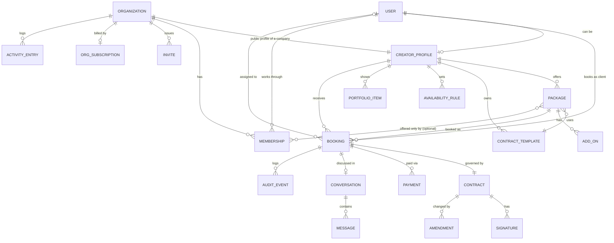
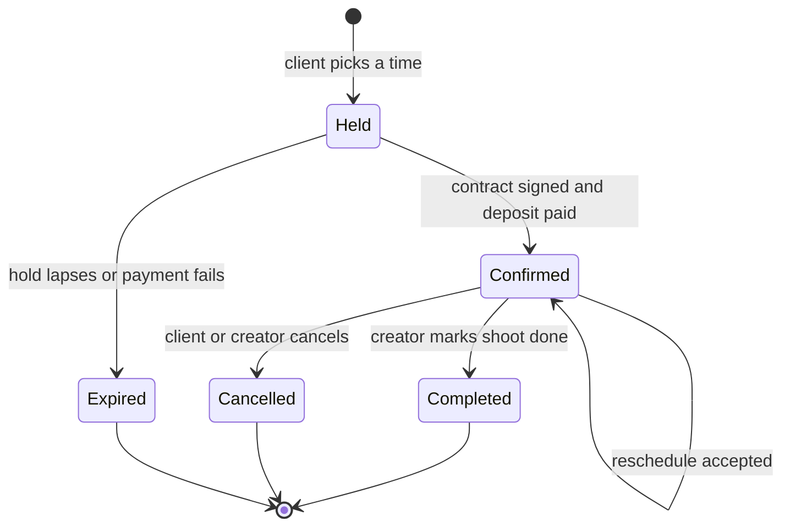

# Product Spec: Booking with Built-in Contracts for Creators

**Status:** Draft v0.2 · 2026-10-22 · Working title: *Slate* (placeholder)
**Platform:** iOS and iPadOS first (SwiftUI). A lightweight web booking page for clients.
**Changes in v0.2:** two account types, Individual and Company (sections 2, 4.1 to 4.4, 5.4, 6, 7, 8.7 to 8.11, 9, 10, 12, 13). Team accounts moved from "Later" into scope.

---

## 1. Summary

An iOS app for videographers, photographers and freelance creators to sell their services and get booked, in the way Booksy does for salons. The difference is that **every booking produces a signed contract**. Clients can't book without agreeing to the creator's terms, and creators never chase signatures, deposits or "what did we agree?" threads.

**Positioning:** Booksy handles scheduling and payment for appointments. Creators who shoot weddings, events, brand work or portraits have a different problem. Each job has scope, deliverables, usage rights, travel, a deposit and cancellation terms, and those usually live in a PDF, a DM thread and a payment link. This app puts them in one flow.

**The promise:**
- *Creator:* share one link and receive bookings that are already signed and deposit-paid.
- *Client:* pick a package and a time, then sign and pay in three taps or fewer.

## 2. Decisions locked and assumptions

Decisions made with the product owner:

| # | Decision | Consequence |
|---|---|---|
| D1 | **Design rules** are the Apple-native rules (section 3). No CLAUDE.md exists in the repo. | Section 3 is normative. A CLAUDE.md should be created from it (see section 13). |
| D2 | **Creator booking link first.** There is no marketplace or search in the MVP. | No cold-start problem. The creator brings their own audience. Discovery is a later phase. |
| D3 | **Contracts = templates plus in-app e-signature.** The creator attaches a template to each package. The client reviews and signs inside the booking flow. We store a timestamped audit trail and a PDF. | We build template, signing and PDF/audit infrastructure ourselves. Legal review is required before launch. |
| D4 | **Payments = deposit at booking** via Apple Pay and Stripe Connect. The balance is due later. | A booking is confirmed only when the contract is signed and the deposit is paid. |
| D5 | **Two account types**, chosen after Sign in with Apple: **Individual** ("Just me") and **Company** ("My company"). An Individual can upgrade to a Company later without losing profile, services, bookings or contracts. | Section 4.1. Team accounts are no longer deferred. |
| D6 | **Company seats are billed with Stripe Billing, per seat.** The company plan is bought and managed on the web in a system sheet. No In-App Purchase. Individual accounts stay free. | App Review risk R9. Billing state lives on the organization (section 7). |
| D7 | **The 10-seat minimum is a billing floor,** not a member count. A company can have fewer than 10 members and is billed for at least 10 seats. The maximum is 250. Both numbers are config values (section 4.4). | Changing them is a config change, not a code change. |
| D8 | **On upgrade, services move to the company, signed work stays with the person.** Services, packages and contract templates become company-owned. The person's availability stays on their own calendar, which becomes their member calendar. Executed contracts and their bookings stay with the person as the contracting party, because they are immutable and the client agreed to that person. | Section 8.7. |
| D9 | **Company payments go to the company's own Stripe Connect account.** Optional member payouts are a **split ledger** (a per-member share recorded on each booking for reports and payroll). Slate makes no automatic transfers to members. | Section 4.3. Stripe transfers to members are Later. |
| D10 | **Company defaults:** bookings are auto-assigned unless an Admin switches the company to manual assignment. Invites are single-use links shared through the system share sheet (no server-sent email yet). Contracts are countersigned automatically by a **designated signer**. | Sections 6, 8.8, 8.9. |

Assumptions, open to change (section 13):

- **A1.** The MVP launches in one country (US, USD) under ESIGN/UETA.
- **A2.** Clients can book without installing the app. The booking link opens the app if installed and otherwise a minimal web page. An App Clip is the alternative to evaluate (section 13, Q4).
- **A3.** Minimum OS is iOS 17. Newer system looks (e.g. Liquid Glass) come from using system components, not custom chrome.
- **A4.** Instant booking only. A creator-approval "request to book" mode comes later.
- **A5.** The backend is required (contracts, payments, web link, email) and is built or bought separately from this spec.
- **A6.** One person can belong to several companies and can own more than one. Each membership has its own role. The account switcher (section 9) moves between them.
- **A7.** A team member needs a person profile (display name, handle, avatar, bio, specialties). It is created in the join flow if they have none, and it is also their member sub-profile on the company page. Their availability and calendar are attached to it.
- **A8.** A company is US and USD like everyone else (A1). One currency per company.
- **A9.** A company has exactly one Owner. Ownership can be transferred, and an Owner must transfer or delete the company before deleting their own account.
- **A10.** Invite links expire after 7 days (config value). The link is the credential. The email typed on an invite is only a label and an address for the Mail sheet, because Hide My Email relay addresses make matching unreliable (R6).

## 3. Design rules (normative)

These come from the product owner's brief and apply to every screen.

| Rule | How it applies here |
|---|---|
| Swift and SwiftUI, iOS/iPadOS first, follow Apple's HIG | No custom navigation paradigms. The web booking page mirrors the same visual language (system font stack, `prefers-color-scheme`). |
| System fonts (SF Pro), Dynamic Type, SF Symbols, system colors | Light and Dark Mode come for free. Contracts and booking screens must stay usable at the largest accessibility text sizes. |
| Native patterns: `NavigationStack`, `TabView`, sheets with detents, swipe actions, pull to refresh, context menus | Tabs: **Home, Bookings, Services, Messages, Profile**. The booking flow is a sheet with `medium` and `large` detents. Bookings and messages use swipe actions. Packages, bookings and contracts use context menus. Lists support pull to refresh. |
| Generous whitespace, rounded cards, subtle materials, spring animations, haptics on key actions | Haptics: slot selected, contract signed, payment succeeded, booking cancelled. Animations respect Reduce Motion. |
| Sign in with Apple, Apple Pay, EventKit, push, widgets | See sections 5 and 8. |
| Accessibility first: VoiceOver labels, contrast, 44pt targets | A typed signature is the default so signing never depends on drawing precision. A drawn signature always has a typed alternative. Contract clauses are exposed as headings for VoiceOver. The PDF is tagged. |
| **Booking takes 3 taps or fewer** | Defined precisely below. |

**The 3-tap rule, defined.** Taps are counted from the tap that opens the booking sheet to the tap that confirms. System authentication (Face ID, side-button confirmation for Apple Pay) and typing don't count as taps.

| Path | Taps | Notes |
|---|---|---|
| Choose package → choose time → **Sign & pay deposit** | **3** | The earliest slot is preselected, so accepting it makes this 2. |
| "Book again" from Home → **Sign & pay deposit** | **2** | Same package, earliest slot preselected. |
| Add-ons, a different day, or editing the signing name | +1 each | Optional and opt-in. The "Soonest available" chips show the next several slots across days, so a different day is rarely needed. |
| **Exceptions** | >3 | (a) First-time web guests must verify an email code. (b) Creators can require a drawn signature or a full read-through on high-value packages. Both are documented exceptions, and each must be justified in the design review. |

Contracts and 3 taps seem to conflict, and the design resolves it this way. The contract is *summarised* in a key-terms card inside the booking sheet (what, when, where, price, deposit, balance due date, cancellation terms, usage rights, delivery date). The full text is one tap away. The primary button is labelled **"Sign & pay $X deposit"**. Next to it sits the signer's name (prefilled from their Apple ID) and a consent line: *"By tapping, I agree to the contract and sign it electronically."* Whether this is enough for enforceability is a legal question (section 12, R1).

## 4. Roles and account types

One account (Sign in with Apple) can hold both roles. A photographer can hire a videographer. The role is a capability on the account, switched from Profile. Section 4.1 adds a second, separate axis: whether the person sells as an **Individual** or as part of a **Company**.

| | **Creator** | **Client** |
|---|---|---|
| Who | Videographer, photographer, freelance creator who sells packages | A person or business booking a creator (couples, event hosts, brands, agencies) |
| Identity | Sign in with Apple, then creator onboarding (legal name, Stripe Connect) | Sign in with Apple in the app. On web: name and email, verified by a one-time code (guest). A guest account can be upgraded later. |
| Surfaces | iOS app only in the MVP | iOS app or web booking page |
| Core jobs | Set up packages, contracts and availability. Share the link. Get paid. Manage bookings and changes. | Pick a package and time. Understand the terms. Sign and pay. Keep the contract. Reschedule or cancel. |

Out of the MVP: an internal support/admin role beyond the console below. The MVP does include a **minimal internal console** for support (view a booking, contract and audit log, void a contract, refund). It isn't customer-facing. Studio and team accounts are covered by section 4.1 onward.

**Permissions at a glance (Individual creators and clients)**

| Capability | Creator | Client |
|---|---|---|
| Create and edit packages, templates, availability | Yes | No |
| Book a package | Yes (as a client of another creator) | Yes |
| View a booking and its contract | Own bookings | Own bookings |
| Cancel a booking | Yes (full refund to client) | Yes (refund per policy) |
| Propose a reschedule | Yes | Yes (the other party accepts) |
| Message in a booking thread | Yes | Yes |
| Edit a signed contract | No, only amendments accepted by both parties | No |

### 4.1 Account types

A person who sells services picks one of two account types in onboarding, right after Sign in with Apple. The choice screen is two cards on a plain grouped background: **Just me** (an individual freelancer) and **My company** (a business or team, 10 or more people). Clients never see this screen. They book without choosing a type.

| | **Individual ("Just me")** | **Company ("My company")** |
|---|---|---|
| Who owns the profile, services, calendar, contracts and payouts | The person | The **Organization**. People work under it through a **Membership** with a role. |
| Public booking link | `handle` of the person | `handle` of the company, plus an optional link per bookable team member |
| Contracts are made with | The person (their legal name) | The company (its legal name), countersigned by a designated signer |
| Money goes to | The person's Stripe Connect account | The company's own Stripe Connect account |
| Calendar | One calendar | One calendar **per member**, with a team view |
| Cost | Free | Per seat, billed with Stripe Billing (section 4.4) |

**Upgrade.** An Individual can become a Company from Profile at any time (flow in 8.7). Nothing is lost: services, packages and templates move to the new organization, while the personal profile, portfolio, availability and every existing booking and contract stay where they were and remain visible. Executed contracts and their bookings stay with the person (D8). The person becomes the Owner and their personal profile becomes their member sub-profile. The company profile starts prefilled from it (bio, location, specialties) and builds its own portfolio. A downgrade back to Individual is possible only when the Owner is the sole member (8.11).

**A person can hold both.** Someone can have a personal Individual presence and also be a member of one or more companies (A6). Each shows as an account in the switcher (section 9). A booking always belongs to exactly one of them.

### 4.2 Company roles

Five roles. "Creator" here means a team member who shoots and is distinct from the account-level creator capability in section 4. Each person has one role per company.

| Role | Intent |
|---|---|
| **Owner** | Billing, deleting the company, and everything else. Exactly one (A9). |
| **Admin** | Manages the team, services, pricing and contract templates. |
| **Manager** | Assigns and manages bookings and views reports. |
| **Creator** | Manages their own calendar and their assigned bookings. |
| **Viewer** | Read only. |

### 4.3 Permissions (normative, enforced on the backend)

Every row is a permission key. The same matrix is implemented in SQL (`org_role_allows`) and in Swift (`OrgPermission`), and a shared fixture (`team_permissions.json`) is checked by both test suites. The app hides what a role can't do, but the **backend refuses it regardless of what the app sends** (row level security and function checks), and tests exercise each refusal.

| Permission | Owner | Admin | Manager | Creator | Viewer |
|---|---|---|---|---|---|
| `company.delete` delete the company | ✓ | | | | |
| `billing.manage` plan, seats, invoices | ✓ | | | | |
| `payments.connect` company Stripe Connect account | ✓ | | | | |
| `payouts.split` set member shares in the split ledger | ✓ | | | | |
| `company.edit` company profile, portfolio, settings, assignment mode | ✓ | ✓ | | | |
| `team.invite` create and revoke invites | ✓ | ✓ | | | |
| `team.manage` change roles, remove members, member listing flags | ✓ | ✓ | | | |
| `services.manage` shared services, packages, pricing, add-ons, per-member services | ✓ | ✓ | | | |
| `templates.manage` contract templates | ✓ | ✓ | | | |
| `signer.designate` choose the designated signer | ✓ | ✓ | | | |
| `activity.view` the activity log | ✓ | ✓ | | | |
| `bookings.assign` assign or reassign a booking | ✓ | ✓ | ✓ | | |
| `bookings.manage` act on any booking (cancel, reschedule, complete, deliver) | ✓ | ✓ | ✓ | | |
| `bookings.view_all` see every booking and its contract | ✓ | ✓ | ✓ | | ✓ |
| `reports.view` earnings and booking reports | ✓ | ✓ | ✓ | | ✓ |
| `bookings.manage_assigned` act on bookings assigned to me | ✓ | ✓ | ✓ | ✓ | |
| `calendar.manage_own` my availability and busy times | ✓ | ✓ | ✓ | ✓ | |
| `calendar.view_team` the team calendar | ✓ | ✓ | ✓ | ✓ | ✓ |
| `team.view` the member list | ✓ | ✓ | ✓ | ✓ | ✓ |

Rules the matrix can't express:

- **Who can change whom.** The Owner can change anyone else. An Admin can invite, change and remove Managers, Creators and Viewers, and can't touch the Owner or other Admins. Only the Owner promotes someone to Admin or demotes an Admin. Nobody changes their own role. Nobody but the Owner can transfer ownership.
- **Bookable members.** Owner, Admin, Manager and Creator can be assigned bookings. A Viewer can't. A member can also be switched off as bookable (for example a Manager who doesn't shoot).
- **Authorised signers.** The designated signer is an Owner or an Admin by default. The Owner can allow Managers too (a company setting). A role not on that list can't be designated.
- **Last Owner.** The Owner can't leave, be removed or be demoted. They transfer ownership first.
- **Removed members** lose access immediately. Their assigned future bookings go back to the unassigned queue for a Manager (8.10). Their personal profile and anything they own personally is untouched.
- **A lapsed plan** (billing canceled or unpaid past the grace period) makes the company read only for everyone except the Owner, who can fix billing. Existing bookings, contracts and history stay readable (R7).

### 4.4 Config values

Kept in one place per layer (`app_settings` in SQL, `TeamConfig` in Swift) so they can change without touching rules code.

| Key | Default | Meaning |
|---|---|---|
| `seats.minimum` | 10 | Billing floor: a company is billed for at least this many seats. |
| `seats.maximum` | 250 | Most members a company can have, counting pending invites. |
| `invites.expiry_days` | 7 | Lifetime of an invite link. |
| `billing.grace_days` | 7 | How long a company stays usable after a failed seat payment before it becomes read only. |

Seat accounting: **seats used** = active members. **Seats billed** = `max(seats.minimum, seats used)`. Pending invites are not billed until accepted, but count toward `seats.maximum`. Seat additions are prorated by Stripe immediately. Reductions take effect at the next renewal, and the screen says exactly when and what changes before the Owner confirms.

## 5. Core features

Legend: **MVP** = in the first release. **Later** = post-MVP.

### 5.1 Creator

| Feature | Detail | Phase |
|---|---|---|
| Onboarding | Sign in with Apple, then business name, handle, legal name and address (needed in contracts), categories, then Stripe Connect Express onboarding. Target: link live in under 10 minutes. | MVP |
| Profile and portfolio | Bio, location and travel radius, up to 12 images, external video links (YouTube/Vimeo). | MVP |
| Packages | Name, description, duration, fixed price, deposit (percent or fixed), deliverables list, delivery turnaround, location type (on-location, studio, remote), travel fee, add-ons, cancellation policy, attached contract template. | MVP |
| Contract templates | Starter templates plus a clause editor with merge fields. Versioned. Creator authorises auto-countersign at publish. See section 6. | MVP |
| Availability | Weekly hours, date exceptions, buffer before and after, minimum notice, maximum advance, max bookings per day. | MVP |
| Booking link | `handle` URL and QR code, shared with the system share sheet. Opens the app if installed, else the web page. | MVP |
| Bookings dashboard | Upcoming, past, needs-attention (balance overdue, change requested). Swipe actions and context menus. | MVP |
| Changes | Accept or decline a reschedule. Cancel with a refund. | MVP |
| Messages | One thread per booking. System messages for events. | MVP |
| Earnings | Read-only summary of payments and Stripe payouts. | MVP |
| Calendar | Confirmed bookings added to Apple Calendar via EventKit. | MVP |
| Widget | "Next shoot": small, medium and lock-screen accessory sizes. | MVP |
| Import busy times from personal calendars | Avoid double-booking against non-app events. | Later (fast follow) |
| Request-to-book, custom quotes and proposals | For bespoke jobs. | Later |
| Second shooters, team accounts | Moved into scope as Company accounts, section 5.4. | See 5.4 |
| Client gallery delivery | Integrate with an existing gallery tool rather than build one. | Later |

### 5.2 Client

| Feature | Detail | Phase |
|---|---|---|
| Book from a link | Package, optional add-ons, time, key terms, sign and pay. | MVP |
| Sign in | Sign in with Apple, or on web a name and email verified by a one-time code. | MVP |
| Pay deposit | Apple Pay (iOS and Safari). Card fallback on web through Stripe. | MVP |
| My bookings | Status, contract, payments, next steps. | MVP |
| Pay balance | One-tap Apple Pay from a reminder, due N days before the shoot (default 7). | MVP |
| Change or cancel | Reschedule request. Cancel with refund shown per policy *before* confirming. | MVP |
| Contract access | Signed PDF in the booking, shareable from the system share sheet. Emailed to both parties. | MVP |
| Messages | Booking-scoped. | MVP |
| Calendar, reminders, widget | EventKit event with an alarm. Push at 24 h and 1 h. | MVP |
| Saved creators and rebook | The client's **Services** tab shows creators they've booked, with their packages. | MVP |
| Reviews and ratings, discovery and search | | Later |

### 5.3 Platform

Backend API, Stripe Connect integration, PDF generation, append-only audit log, transactional email, APNs, universal links, and the minimal support console.

### 5.4 Company accounts

Everything in 5.1 applies to a company, owned by the organization instead of a person. These are the additions.

| Feature | Detail | Phase |
|---|---|---|
| Account type choice | Two cards after Sign in with Apple: Just me, My company. | MVP |
| Upgrade to Company | From Profile, keeps profile, services, bookings and contracts (D8). | MVP |
| Company profile | Name, logo, bio, portfolio (up to 12 items), location, handle, legal name and address for contracts. | MVP |
| Team member sub-profiles | Each member's person profile (name, avatar, bio, specialties) plus a title and a "show on company page" flag. | MVP |
| Seats | Billing floor and maximum from config (section 4.4). | MVP |
| Invites | Single-use link, shared with the system share sheet. Typing an email pre-addresses the Mail sheet. Revocable, expires. | MVP |
| Roles and permissions | Owner, Admin, Manager, Creator, Viewer, enforced on the backend (section 4.3). | MVP |
| Shared services | Company packages, add-ons, pricing and contract templates that Owner and Admin control. | MVP |
| Per-member services | A company service offered by only chosen members, so a client can book that person. | MVP |
| Book the company | The client picks a package and a time. The booking is assigned to a member (auto by default, or by a Manager). | MVP |
| Book a member | The client picks a person on the company page and books them directly. | MVP |
| Team calendar | Everyone's availability and bookings, filterable by member. A person is never double booked. | MVP |
| Company contracts | Made in the company's name, countersigned automatically by the designated signer. | MVP |
| Company payments | Deposits and balances go to the company's Stripe Connect account. | MVP |
| Member split ledger | Optional per-member share recorded on each booking, shown in reports. | MVP |
| Activity log | Who changed bookings, contracts, prices and team members. | MVP |
| Seat billing | Stripe Billing per seat, with upgrade, downgrade and remove-member flows. | MVP |
| Account switcher | Move between Personal and each company, from Profile. | MVP |
| Automatic Stripe transfers to members | Members connect their own account and shares are transferred. | Later |
| SSO, SCIM, audit export | Enterprise administration. | Later |
| Per-member public pages with their own packages that members create themselves | Members managing their own services. | Later |

## 6. Contracts

This is the differentiator, so it gets its own section.

**Templates**
- Three **starter templates**: wedding or event, portrait or session, and commercial or brand. They are clause-based and editable.
- A template is an ordered list of clauses. Each clause has a title and body and can use **merge fields**: client name, event date, location, package name, price, deposit, balance due date, deliverables, delivery date, cancellation terms, usage rights, travel fee, overtime rate.
- Clauses are either editable or **system-locked**. Locked clauses include the e-sign consent and the parties block.
- Editing a template creates a new **version**. Existing bookings keep the version their client signed.
- Starter templates are not legal advice and are marked as such in the app.

**At booking**
1. The system merges the booking data into the package's template and produces an **immutable contract instance**: the rendered text, the template version, and a SHA-256 hash of the document.
2. The client sees the key-terms card and can open the full text.
3. The client signs with a **typed signature** (default, prefilled) or a **drawn signature** (creator option).
4. The creator's **countersignature** is applied automatically from their stored signature, under the authorisation they gave when publishing the template.
5. When the deposit succeeds, the contract becomes **executed** and the booking becomes **confirmed**.

**Company contracts.** When the provider is a company:

- The parties block names the **company** (its legal name) as provider. It doesn't name the assigned member: a booking can be reassigned after signing and a contract is never edited. The assigned member appears on the booking and on the key-terms card.
- The countersignature is applied automatically by the company's **designated signer**: a named Owner or Admin (or another allowed role, section 4.3) with a title, who authorised auto-countersign when the company published. The signature record stores the signer's name, title, user id and "on behalf of" the company. Every automatic countersignature appears in the activity log.
- Only a person with `signer.designate` can change the designated signer, and only for new contracts. Executed contracts keep the signer they had.
- The countersigner is **fixed when the client signs**. If the designated signer is removed or loses their role afterwards, a contract the client already signed is still completed by that person when the deposit arrives (they held the authority at that moment), while auto-countersign **stops** for new bookings: the company can't take any until a new signer is designated. Contracts are never signed in the name of someone who had no authority when the client signed.
- Upgrading from Individual never rewrites an executed contract (D8). Those contracts keep the person as provider.

**Signature record and audit trail** (per signer): signed name, method, consent-text version, timestamp, IP address, device and user agent, locale, email at signing, and how the identity was verified (Apple ID or email code). The executed PDF carries a **certificate page** with this data and the document hash.

**Ordering rule.** Signing and paying happen in one step. If payment fails or the hold lapses, the signature is voided, the contract never becomes executed, and the client is told. Money and a contract are never in a half-finished state that either party can rely on.

**Changes after signing.** Rescheduling, scope changes and cancellations produce an **amendment** that both parties must accept. The original contract is never edited. A cancellation records the outcome and the refund applied.

**Retention and deletion.** Account deletion is available in-app (App Store requirement). Executed contracts must be retained for legal reasons, so deletion removes personal data where the law allows and retains the contract and audit record. The retention period is an open question (Q10).

## 7. Data models

Entities, key fields and relationships. This is a conceptual model, not a schema.

**The owner field.** Services (packages and their templates), bookings, contracts and payments accounts all carry an **owner** that is either a person or an organization. It is stored as a reference to a **CreatorProfile**, and a profile has a `kind` of `person` or `company`. A person's profile id is their user id. A company's profile id is its organization id. So a foreign key keeps the owner real, and "who owns this" is one lookup (`kind`), not a loose pair of columns. Team access is never inferred from the owner id alone: every read and write goes through the membership and role checks in section 4.3.

| Entity | Key fields | Notes |
|---|---|---|
| **User** | id, Apple subject id (nullable for guests), email, email verified, display name, timezone, locale, roles (client always, creator optional), deleted at | Guest clients are Users created by email code and can be merged into an Apple ID later. Hide My Email relay addresses are supported (section 12, R6). |
| **CreatorProfile** | **kind (person or company)**, user id (null for a company), handle (unique), business name, legal name, legal address, bio, categories, base location and travel radius, currency, stripe account id, charges and payouts enabled, stored signature, published flag | Publishing requires charges enabled. A private preview link works earlier. For a company this row is the public page: name, logo, bio, portfolio and location. |
| **Organization** | id (equals its company profile id), legal name, legal address, created by, assignment mode (auto or manual), allowed signer roles, designated signer (user id, title), split ledger on or off, state (active, lapsed, closed), created at, closed at | The administrative record behind a company. One Owner (A9). |
| **Membership** | organization id, user id, role (owner, admin, manager, creator, viewer), title, listed on the company page, bookable, split share (basis points), joined at, removed at | One active row per person per company. Removing a member sets `removed at` so history keeps its meaning. |
| **Invite** | organization id, role, email (label only, optional), token hash, invited by, expires at, status (pending, accepted, revoked, expired), accepted by and at | The token is shown once, when the invite is created. Only its hash is stored. Single use. Never grants Owner. |
| **PackageMember** | package id, user id | Present only for a per-member service. No rows means every bookable member can take the package. |
| **OrgSubscription** | organization id, Stripe customer id, subscription id, status (none, trialing, active, past due, canceled), seats billed, seats scheduled for the next renewal, period end, grace until | Written from Stripe's signed webhook only, never by the app. |
| **ActivityEntry** | organization id, actor (user id and a name snapshot), action, entity type and id, summary, metadata, timestamp | Append only. Written by triggers on bookings, contracts, packages, memberships and the organization, so no code path can forget. It is the company-level counterpart of AuditEvent. |
| **PortfolioItem** | kind (image or video link), url, caption, order | Up to 12 per creator in the MVP. |
| **Package** | **owner (creator id)**, name, description, category, duration, price, deposit rule, deliverables, turnaround days, location type, travel fee, cancellation policy, buffer before and after, template id, status (draft, active, archived) | Booking stores a **snapshot** of the fields below, so later edits never change an existing booking. |
| **AddOn** | package id, name, price, extra minutes, description | Examples: extra hour, second shooter, drone, rush delivery. |
| **AvailabilityRule / Exception** | weekday, start and end, timezone; exception date, blocked or extra, window; settings: minimum notice, maximum advance, daily cap | |
| **CancellationPolicy** | name, rules (hours before → refund percent), applies to deposit and balance | MVP ships three presets: Flexible, Moderate, Strict. Custom policies come later. |
| **ContractTemplate** | **owner (creator id)** or system, title, category, version, clauses (title, body, locked), merge fields used, status, auto-countersign authorised at | Starter templates are system-owned and cloneable. |
| **Contract** | booking id, **owner (the provider party)**, template id and version, rendered body, document hash, parties (for a company: the company's legal name and the designated signer's id, name and title, fixed when the client signed), status (pending signature, executed, voided, superseded), executed at, PDF url, certificate url | Immutable once created. |
| **Signature** | contract id, signer role and user, signed name, method (typed, drawn, stored), consent-text version, signed at, IP, device, locale, email at signing, verification method | |
| **Amendment** | contract id, reason, change summary, proposed by, status (proposed, accepted, declined), accepted by both at | Used for reschedules and scope changes. |
| **Booking** | creator id (**the owner**), **assigned to (user id; equals the owner for an Individual)**, **requested member (true when the client chose that person)**, **assignee share (basis points, snapshot)**, client id, package id, **package snapshot**, add-ons snapshot, start and end, timezone, location, client brief, status, total, deposit, balance, balance due at, cancellation policy snapshot, contract id, created via (app, web), hold expires at, cancelled by and reason | Double booking is prevented per **assigned person**, not per owner, so a company's members work in parallel and each person is still never in two places. A company booking in manual-assignment mode has no assignee until a Manager assigns one (8.10). |
| **Payment** | booking id, kind (deposit, balance, refund, adjustment), amount, currency, platform fee, Stripe payment intent id, status, method (Apple Pay, card), paid at | Money is stored in minor units. |
| **Payout** (read-only mirror) | creator id (**the owner**), Stripe payout id, amount, status, arrival date | For the earnings screen. Stripe is the source of truth. A company's payouts are those of its own Connect account. |
| **Payment account** | creator id (**the owner**), Stripe account id, charges enabled, payouts enabled, details submitted | One per owner. A company's is separate from the personal one of any member. |
| **Conversation / Message** | booking id, participants; sender, kind (text, system), body, sent at, read by | System messages are generated for booking, signing, payment and change events. |
| **Device / NotificationPreference** | user id, APNs token, environment; per-event toggles | |
| **AuditEvent** | entity type and id, actor, action, metadata, IP, timestamp | Append-only. Covers bookings, contracts, payments and changes. |

**Booking lifecycle**

- A **Held** booking reserves the slot for 10 minutes (proposed) so two clients can't book the same time.
- **Balance** is a payment state, not a booking state: `balance due`, `paid`, `overdue`. Overdue balances notify both parties and surface in the creator's needs-attention list.
- If the **creator cancels**, all payments are refunded in full automatically.
- If the **client cancels**, the refund follows the policy snapshot stored on the booking.

## 8. User flows

### 8.1 Creator onboarding and first link

1. Sign in with Apple.
2. Basics: business name, handle, categories, legal name and address (explained: "used in your contracts").
3. First package from a starter, with a starter contract template preselected. The creator can accept defaults and edit later.
4. Availability, prefilled Monday to Friday, 9:00 to 17:00, editable.
5. Stripe Connect Express onboarding in a system web authentication sheet. Stripe handles identity checks.
6. Authorise auto-countersign and store a signature.
7. Publish, then share the link and QR code through the system share sheet.

*Success:* a published link in under 10 minutes, excluding Stripe's own verification time. Until Stripe verification completes, the creator can use a private preview link only.

### 8.2 Client books (link to confirmed)

1. Client opens the link. If the app is installed it opens there. Otherwise the web page opens.
2. **Tap 1:** pick a package. The booking sheet opens with the earliest slot preselected.
3. **Tap 2:** pick a time from the "Soonest available" chips. Optional: add-ons, or "Other dates" for a full day and time picker.
4. The sheet shows the key-terms card, a "Read full contract" link, the signer name (prefilled), and the price breakdown (total, deposit now, balance later with due date).
5. **Tap 3:** **Sign & pay $X deposit**. Apple Pay authorises with Face ID or the side button.
6. Confirmation: haptic, animation, "Add to Calendar", signed PDF available, emails sent, creator notified.

*Failure paths:* payment fails (signature is voided, the client can retry within the hold), hold expires (offer the next slot), slot taken meanwhile (offer alternatives), Apple Pay unavailable (card fallback on web, "Add a card" prompt in the app).

### 8.3 Balance payment

1. N days before the shoot (default 7), push and email: "Balance of $X due."
2. Client taps the notification, then **Pay balance** with Apple Pay.
3. Creator sees "Paid in full". If still unpaid after the due date, both are notified and the booking appears under the creator's needs-attention list.

### 8.4 Reschedule

1. Either party taps **Reschedule** (swipe action or context menu) and picks a new time inside the creator's availability.
2. The other party gets a notification with the proposed time and accepts or declines.
3. On acceptance, an amendment is recorded and signed by both parties, the calendar event and reminders update, and the signed amendment is appended to the contract PDF.

### 8.5 Cancel

1. Either party taps **Cancel**. A confirmation sheet shows the **exact refund** the policy produces *before* the final tap.
2. The booking is cancelled, the refund is issued, the contract is marked terminated with the outcome, and both parties are notified.
3. The calendar event and reminders are removed.

### 8.6 After the shoot

1. The creator marks the booking **Completed**.
2. If the balance is unpaid, the reminder flow continues. If it's paid, the booking moves to Past.
3. Both can still open the signed PDF at any time.

### 8.7 Choose a type, create or upgrade a company

**New account.** After Sign in with Apple, the choice screen shows **Just me** and **My company**. *Just me* continues with 8.1 unchanged. *My company* runs:

1. Company basics: company name, handle, categories, legal name and address ("used in your contracts").
2. You as the Owner: your name and photo. If you have no person profile one is created here (A7).
3. Plan: the seat floor, the per-seat price from Stripe, and a button that opens the Stripe checkout in a system web authentication sheet. Until the plan is active, the company can be set up but can't be published or invite anyone.
4. First shared service from a starter, with a starter template.
5. Designated signer: you, with your stored signature, and the auto-countersign authorisation.
6. Stripe Connect Express onboarding for the **company** account.
7. Publish and share the link and QR code.

**Upgrade an existing Individual** (Profile, "Upgrade to a company"):

1. A plain summary of what moves (services, packages, templates) and what stays (profile, portfolio, availability, every booking and contract, your Stripe account for existing bookings).
2. Company name, handle, legal name and address. Nothing is created yet.
3. **Upgrade.** One request creates the organization, the company profile, your Owner membership, and moves your services. If a booking of yours is in its 15-minute hold, the upgrade waits for it ("Try again in a few minutes") so a client never pays into a half-moved record.
4. The setup continues at step 3, 5, 6 and 7 of the new-account flow.

Balances on existing bookings are still paid to the personal Stripe account. Existing signed contracts still name the person.

### 8.8 Invite a team member

1. Settings, Team, **Invite** (needs `team.invite`). Pick a role (never Owner) and optionally type an email.
2. Slate creates a single-use invite and opens the system share sheet with the link. If an email was typed, a pre-addressed Mail compose sheet is offered. The link is shown once. A lost link is replaced, not recovered: **Resend** revokes the old invite and makes a new one.
3. Pending invites are listed with swipe actions: **Revoke** and **Resend**. They expire after `invites.expiry_days`.
4. The invitee opens the link. The app opens, they sign in with Apple (their own login), see "Join Acme Films as Creator", add a name and handle if they have no profile, and tap **Join**.
5. An invite can't be created when the plan isn't active or the seat maximum would be exceeded, and the screen says which.

### 8.9 A client books the company or a member

1. The client opens the company link. The page shows the company profile, its services, and cards for the listed, bookable team members.
2. **Book the company.** Package, then time, then **Sign & pay**: the same 3 taps as 8.2. Times shown are those where **at least one eligible member is free** (a member is eligible when the package is offered by everyone or by them). In *auto* mode the booking is assigned immediately to the free eligible member with the fewest upcoming bookings (ties go to whoever joined first). In *manual* mode it is confirmed with no assignee and waits in the Managers' queue (8.10), and the times offered are limited so unassigned bookings never exceed the members who could take them.
3. **Book a member.** On a member card, **Book Dana** opens the same sheet with that member's packages and only that member's free times. The booking records that the client asked for that person.
4. The contract is in the **company's name** (section 6). The key-terms card shows the assigned member ("Your photographer: Dana") once there is one.

### 8.10 Assign, reassign and the team calendar

1. A **Needs assignment** list (Home and Bookings, for people with `bookings.assign`) holds bookings in manual mode and those returned by a removed member. Tapping one lists members who are free at that time. Busy members are shown disabled with the reason ("Busy 10:00 to 12:00"). Assigning notifies the member and the client.
2. **Reassign** is in the booking's context menu. If the client asked for that person, the sheet says so and asks for confirmation.
3. The **Team calendar** (Bookings, Team) shows a day or week with a filter chip per member. Availability is a light band and bookings are solid blocks. A Creator opens on their own calendar and can switch to the team.
4. The backend refuses an assignment that would put a person in two places, however the request arrived.

### 8.11 Seats, plan changes and leaving

- **Adding members.** Seats rise when an invite is accepted. The Owner sees "14 seats used, 14 billed, 250 maximum".
- **Removing a member** (swipe on the member row, or Settings, Team). The confirmation says what happens: their future bookings return to the assignment queue, they lose access immediately, and the seat is released at the next renewal (never below the floor). If they are the designated signer, it says auto-countersign will stop until a new signer is chosen.
- **Billing** (Owner): payment method, invoices and plan cancellation open in Stripe's hosted portal in a system sheet. A failed payment starts the grace period, and a banner tells the Owner and Admins.
- **Cancel the plan.** At the end of the period the company becomes read only (lapsed). The Owner can resubscribe or downgrade.
- **Downgrade to Individual.** Allowed when the Owner is the only member and nothing is held. The company's services move back to the person, the company page closes, and the company record is kept because executed contracts name it.
- **Leave a company.** Any member except the Owner can leave from Settings, Team. Their bookings return to the queue.
- **Delete a company** (Owner, with a confirmation that names what is retained). Executed contracts and the activity log are retained (R7).

## 9. Screens and navigation

One `TabView` with five tabs, **role-aware**. Each tab owns a `NavigationStack`. Tab labels are the same for both roles.

| Tab | Creator | Client |
|---|---|---|
| **Home** | Today and this week, needs-attention list, link and QR shortcut, earnings snapshot | Next booking, "Book again", action items (balance due) |
| **Bookings** | Upcoming and Past, swipe actions (reschedule, cancel), detail with contract and payments | Same, plus pay balance |
| **Services** | Packages, contract templates, availability, portfolio | "Creators": those the client has booked or saved, with their packages |
| **Messages** | Booking threads, unread badge | Booking threads |
| **Profile** | Business profile, Stripe and payouts, calendar and notification settings, role switch, sign out, delete account | Account settings, payment methods, calendar and notification settings, role switch, sign out, delete account |

**Key surfaces:** the booking sheet (`medium` and `large` detents), the full-contract reader (`large` sheet), signature capture, the cancel confirmation (shows the refund), widgets, and push notification actions.

**Company accounts.** The five tabs and their labels don't change. What changes:

| Where | Change |
|---|---|
| **Account switcher** | At the top of Profile, a tappable header like the Apple ID row in Settings: avatar, name, and the current account ("Personal" or the company with the person's role). It opens a sheet listing Personal and each company, with a checkmark on the current one. Switching changes what every tab shows. The choice is remembered per device. |
| **Settings, Team** (company only) | A grouped section: Members, Invites, Company settings, Billing (Owner), Activity (Owner, Admin). Rows a role can't use are hidden, not disabled. |
| **Members** | A list of people with role and title. Swipe actions: **Change role** and **Remove** (trailing), and a context menu with the same. Roles the actor can't set are not offered. |
| **Home** | Adds a "Needs assignment" card for people who can assign, and a team snapshot for Viewers. |
| **Bookings** | Adds a **Team** segment: the team calendar with a filter chip per member (8.10). Rows show the assigned member. |
| **Services** | Company services with an "Offered by" line (everyone, or the chosen members). Templates are managed here by Owner and Admin. |
| **Profile** | The company profile editor, designated signer, Stripe Connect for the company (Owner), and the split ledger setting (Owner). |

Each of these follows the design rules in section 3: system components, sheets with detents, swipe actions, context menus, and the same Dynamic Type and VoiceOver behaviour as everything else.

## 10. MVP scope

**Release goal.** A creator can set up and publish a bookable link in under 10 minutes. A client can book, sign and pay a deposit in three taps or fewer. Both receive a signed PDF. The creator receives the money.

**In the MVP:** everything marked **MVP** in section 5, plus the platform pieces in 5.3.

**Not in the MVP:**

| Area | Deferred |
|---|---|
| Discovery | Marketplace, search, categories, ratings and reviews |
| Booking modes | Request-to-book, custom quotes and proposals, recurring bookings, waitlists |
| Money | Installments and milestones, invoices beyond deposit and balance, tax, multi-currency, promo codes, creator subscriptions |
| Contracts | Third-party e-sign providers, model and property releases, usage-rights licensing add-ons, AI drafting |
| Teams | Automatic Stripe transfers to members, SSO and SCIM, audit export, members creating their own services. (Company accounts themselves are in scope, section 5.4.) |
| Integrations | Google Calendar or personal-calendar busy-time import, client gallery delivery |
| Platform | Android, iPad-specific features beyond adaptive layout, Live Activities, in-app video calls |
| Support | Dispute and chargeback tooling beyond the minimal support console |

**Proposed success metrics** (targets to be confirmed; these are not commitments):

| Metric | Why it matters |
|---|---|
| Creators with a published link and at least one package, divided by sign-ups | Activation |
| Link views to confirmed bookings | Conversion |
| Median taps and time from package selection to confirmed | Validates the 3-tap rule |
| Share of confirmed bookings with an executed contract | Should be 100% by construction |
| Deposit success rate and balance on-time rate | Payment health |
| Creators paid out within the expected window | Trust |

**Suggested milestones** (no dates, because team size is unknown):

| Milestone | Outcome |
|---|---|
| M0 Foundations | Design system, backend skeleton, Sign in with Apple, Stripe Connect sandbox |
| M1 Creator setup | Profile, packages, availability, link and QR |
| M2 Booking and contract core | Booking sheet, template merge, signing, PDF and certificate, audit log |
| M3 Payments | Deposit with Apple Pay, balance, refunds, payout view |
| M4 Engagement | Messages, push and email, EventKit, widget |
| M5 Beta | Web booking page hardening, accessibility audit, legal review, TestFlight pilot with real creators, App Review preparation |
| M3b Company accounts | Organizations, memberships, roles enforced on the backend, shared services, assignment and team calendar, company contracts and payments, seat billing |

## 11. Non-functional requirements

| Area | Requirement |
|---|---|
| Accessibility | VoiceOver labels and hints on every control. Dynamic Type through the largest accessibility sizes. 44pt minimum targets. Sufficient contrast in Light and Dark. Reduce Motion respected. Typed-signature alternative everywhere. Tagged PDFs. |
| Performance | Booking sheet is interactive in under 1 second after the tap. Upcoming bookings and signed contracts remain readable offline. |
| Security | Contracts are immutable and hash-verified. PDFs are served by short-lived signed URLs. Card data never touches our servers (Stripe and Apple Pay tokens). Audit log is append-only. |
| Team access | A role is checked in the database on every read and write (section 4.3), never trusted from the client. A removed member loses access on the next request. Invite tokens are single use, stored hashed and expire. The activity log is append only. |
| Privacy | Data minimisation. Accurate App Privacy details. EventKit access requested only when the user turns on calendar sync, with a plain explanation. In-app account deletion. |
| Reliability | Slot holds and payment-plus-contract confirmation must be atomic from the user's point of view (section 6, ordering rule). Idempotent payment calls. Reminders must still fire if a push is missed (local notifications as a backup). |
| Compliance | ESIGN/UETA for the launch market. Other markets (eIDAS, etc.) require separate review. |

## 12. Risks

| # | Risk | Mitigation |
|---|---|---|
| R1 | A one-tap "Sign & pay" may not satisfy enforceability in some jurisdictions or for high-value jobs. | Legal review before launch. Key-terms card plus an explicit consent line. Creators can require a drawn signature and full read-through (documented 3-tap exception). |
| R2 | Starter templates read as legal advice. | Clear "not legal advice" labelling. Counsel-reviewed starters. Creators own and edit their terms. |
| R3 | Stripe Connect onboarding is slow and can lose creators. | Preview link before verification. Set expectations in the flow. |
| R4 | App Review: payments for real-world services are generally outside In-App Purchase, but a creator **subscription** for digital features may not be. In-app account deletion is required. | Verify against the current App Review Guidelines before choosing the business model (Q3). |
| R5 | Double-booking against a creator's personal calendar. | Document the limitation in the MVP. Prioritise busy-time import as the first fast follow. |
| R6 | Sign in with Apple "Hide My Email" addresses only receive our email if our sending domain is registered with Apple's private email relay. | Register the sending domain before launch. Test delivery of the signed PDF to a relay address. |
| R7 | Contract retention conflicts with account deletion. | Retain the executed contract and audit record, remove personal data where the law allows, and say so in the deletion flow. |
| R8 | Chargebacks and disputes. | Contract plus audit certificate serve as evidence. Console supports manual handling in the MVP. |
| R9 | **Seat billing and App Review.** Guideline 3.1.3(c) lets an app sold directly to organizations take payment outside In-App Purchase, but consumer and single-user sales must use IAP. A one-person "company" is a grey area, though the 10-seat floor prices the plan for organizations and Individual accounts stay free. | Check the current guideline text before submission. The fallback is StoreKit seat bands (the option declined in D6). |
| R10 | **Cross-company data exposure.** A role check missed in one function, or an owner id trusted from the client, could show one company's bookings or contracts to another. | Permissions are enforced in the database (row level security and function checks), never from the client. Tests try every permission with every role, plus a member of another company, and assert the refusal. |
| R11 | **An upgrade leaves records split between a person and a company,** which can confuse accounting. | The upgrade summary says what moves and what stays. Records show whether they are Personal or the company's. The company's reports cover only the company. |
| R12 | **A removed designated signer halts bookings.** | Removing or demoting the signer is warned about before it happens, and the company shows a banner until a new signer is chosen. |
| R13 | **A company booking in manual mode can sit unassigned** while the client has paid. | Manual-mode capacity is limited (8.9), unassigned bookings are on the Managers' needs-assignment list, and a reminder fires before the shoot if still unassigned. |
| R14 | **Seat counts disagree between Slate and Stripe.** | Seats billed are computed in one place from active members and the floor. Stripe's webhook is the record of what was charged, and the Owner's screen shows both. |

## 13. Open questions

Defaults in brackets are what this spec assumes if you don't change them.

| # | Question | Default |
|---|---|---|
| Q1 | **Product name?** | *Slate* (placeholder) |
| Q2 | **Launch market, currency and legal framework?** | US, USD, ESIGN/UETA |
| Q3 | **How does the platform make money?** Percentage fee per booking, creator subscription, or both. This affects App Review (R4). | Percentage fee per booking (rate TBD) |
| Q4 | **Clients without the app:** lightweight web page, or an App Clip (more native, supports Apple Pay and Sign in with Apple, iPhone only)? And is iPhone-only acceptable for clients? | Web page for the MVP; evaluate an App Clip |
| Q5 | **Who drafts and reviews the starter contract templates?** | External counsel, before beta |
| Q6 | **Minimum iOS version?** | iOS 17 |
| Q7 | **Backend:** build custom, or use a backend-as-a-service? Which email provider? | Undecided |
| Q8 | **Which creator niche first?** Weddings and events, portraits, or commercial. This sets the default package and template. | Weddings and events |
| Q9 | **Defaults for deposit size, balance due date and the three cancellation presets?** | Deposit 30%, balance due 7 days before, Flexible / Moderate / Strict |
| Q10 | **Contract retention period?** | 7 years, subject to legal advice |
| Q11 | **Who bears Stripe processing fees,** the creator, the client, or the platform? | Creator |
| Q12 | **Should I add a `CLAUDE.md`** containing the section 3 design rules, so future work follows them automatically? | Yes |

**Added in v0.2 (company accounts).** The questions asked while adding company accounts (billing method, what the seat minimum controls, what happens to data on upgrade, member payouts, assignment, invites, and who countersigns) are answered and recorded as decisions D6 to D10 and assumptions A6 to A10. These remain open:

| # | Question | Default |
|---|---|---|
| Q19 | **Seat price and free trial length?** The price lives in a Stripe Price object configured outside the app, so the app only shows what Stripe returns. | Price set in Stripe, 14-day trial |
| Q20 | **May Creators add their own services,** or only Owner and Admin? | Owner and Admin only (`services.manage`) |
| Q21 | **May a Viewer see money** (earnings and the split ledger)? | Viewers see `reports.view` totals, not the per-member split |
| Q22 | **How long is the grace period** after a failed seat payment? | 7 days (`billing.grace_days`) |
| Q23 | **Should the company handle share a namespace with personal handles?** | Yes, one unique `handle` space |
